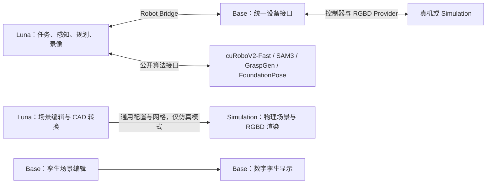

# Luna 与 Tianji Base 接入

Luna 的机器人、夹爪、RGBD 和加工动作统一经过 Base。仓库名保留 `tianji-luna-mujoco`，Luna 运行环境不安装 MuJoCo。算法服务独立运行。



## 控制台与场景归属

日常使用 [Luna](http://127.0.0.1:8350/)：任务、graph、三相机、Decisions、记忆、点云诊断和录像都在这里。机器人显示内嵌 Base 的实测数字孪生，不需要另开 Base 标签页。实测 Viewer 仅发布机器人；Luna 可叠加实测 RGBD 点云和感知建立的碰撞场景，不加载手工场景物体真值。

[Luna 仿真场景面板](http://127.0.0.1:8350/#scene) 完全管理物理场景：常见形状、颜色、CAD、多个实例、位置姿态、质量、逐物体重力和固定状态。Luna 转换 CAD 为米制三角网格和凸分解件，直接提交给 Simulation 校验、编译和保存。Base 不转发场景，也不依赖 CAD 库。配置接口与 RobotGateway、任务 graph、感知及规划接口隔离。

Luna 只有一个 HTML 入口：`/#task`、`/#scene`、`/#spheres`、`/#workspaces`、`/#replay` 与 `/#base` 在同一工作台切换。切换保留任务状态、未提交的场景草稿和回放选择；隐藏的诊断视图停止刷新，视频暂停。Base 控制台在工作台内嵌入。回放深链接为 `/#replay?run=<id>&view=graph`，图片预览和全宽任务图也在当前页。

Base 的“孪生场景”页只改变 Base 自己的数字孪生，不改变 Simulation。Luna 的“重置任务”会停止当前任务。仿真模式同时恢复已应用的物体布局、双臂初始观测位与张开的夹爪，收到 Simulation 版本和 Base 关节反馈才确认完成。真机模式只停止并清理任务。物理场景应用会恢复各物体的配置位置并保留机器人关节状态，必须在仿真空闲、双臂取消使能时操作。自由物体关闭重力后仍能被推动；固定物体不能自由运动。

Base 保留彩色机器人。Simulation RGB 和 Luna 机器人显示为灰白机器人/立柱、黑色夹爪/相机。显示材质不改变几何、标定和 FK。真实相机中的颜色仍由实物决定。

## 自动选择模式与启动顺序

顺序为 **真机/Simulation → Base → Luna**，在各自项目手动逐个启动。Luna 通过所配置 Base 发布的 `runtime_mode` 和 `robot_ip` 自动识别模式，不通过 IP 字符串前缀猜测。切换 Base 地址不需要修改任务代码。真机和身份未知时，前端与 Luna 服务端禁用物理场景编辑。Simulation 自己检查控制器空闲，并将场景编译与控制命令准入互斥；Base 没有物理场景 API。

当前 guangyu 仿真的三个项目统一使用各自目录的 `bash start.sh` / `bash stop.sh`。
每个入口只管理自己的项目；部署参数保存在现有 Compose 配置中，日常不需要输入长命令。

隔离仿真部署位于 Ubuntu `/home/guangyu/projects`，四个项目和 CAD 为同级目录。内部 Docker 网络为 `luna-base-sim-guangyu`，子网 `172.29.79.0/24`、网关 `.1`、`Internal=true`。Base 为 `.2:8000`，Simulation 为 `.3`；相机 8766 和场景管理 8767 仅在内部使用。

第一步，仅启动 Simulation：

```bash
cd /home/guangyu/projects/tianji-simulation
bash start.sh
```

当前 guangyu 配置会在远程 Ubuntu 的 ThinLinc 桌面打开 MuJoCo 窗口；
SSH 终端只显示启动状态。窗口显示完整机器人和已保存的场景，三相机继续提供 RGBD。

第二步，仅启动仿真 Base：

```bash
cd /home/guangyu/projects/tianji_base
bash start.sh
```

第三步，启动 Luna 及它使用的算法服务。日常入口固定使用原来的 `start.sh`：

```bash
cd /home/guangyu/projects/tianji-luna-mujoco
bash start.sh
```

真机 Base 使用以下独立入口；共享平台镜像固定为 `jodell-console:0.2.0`：

```bash
cd /home/guangyu/projects/tianji_base
bash scripts/real_web_dev.sh start \
  --instance guangyu \
  --dev \
  --image jodell-console:0.2.0 \
  --robot-ip 192.168.1.190
# 停止该真机实例
bash scripts/real_web_dev.sh stop --instance guangyu
```

这条 `real_web_dev.sh` 命令保持原样，它内部明确传入 `--mode real`，只用于真机；
不能仅将 `--robot-ip` 换成仿真 IP 就当作上述仿真 Base 的启动命令。
Base 根目录的 `start.sh` 默认使用当前 guangyu 仿真配置，内部 Compose 显式选择 simulation 模式和仿真 RGBD Provider。
Luna 则根据已启动 Base 的身份自动识别目标。

旧的 `tianji-simulation/scripts/start_luna_base.sh` 同时启动 Simulation 和 Base，
因此已按“每个项目手动分别启动”的要求删除；它对应现在的第一步和第二步。
Luna 的 `start.sh`、`stop.sh` 始终存在；`scripts/demo-service.sh` 是它们共用的内部实现，
不是新的日常启动命令。

以上是 guangyu 已部署实例的独立入口，分别管理自己的容器，没有跨项目 `depends_on` 或联合启动脚本。Base 容器为 `tianji-base-guangyu`，Simulation 容器为 `tianji-simulation-guangyu`；各自根脚本明确指定自己的服务。Luna 的脚本只管理网页与四个算法服务。停止其中任何一个项目，都不会停止或重启另外两个项目。

内部网络仅用于 IP 通信；为保留已有配置与场景，两个状态卷沿用历史名字 `luna-base-simulation-guangyu_simulation-state`、`luna-base-simulation-guangyu_base-state`，不代表服务所有权或生命周期依赖。Simulation 不等待 Base，先加载最后一个成功编译的物理场景；没有历史场景则仅有机器人与地面。每条 Compose 命令只等待自身服务健康；Base 可在设备离线时启动，Luna 可在 Base 离线时启动并显示连接状态，任务执行需要有效的 Base 身份。启动本身不连接或驱动机器人，使用“准备设备”后才连接控制器并开启三相机。

2026-11-17 独立启停实测：Base 在其他项目关闭时独立启动成功；删除 Luna 的 `wait_for_base` 启动等待后，Base 离线时 Luna 网页与状态 API 均返回 200。停止 Base 前后，正在运行的 Simulation、Luna 和四个算法容器的 ID、状态、启动时间与重启次数均未变化；Simulation 与 Luna 的停止入口也分别验证了作用范围。证据位于 `data/acceptance/project-lifecycle/`。这项检查不代表两项抓放任务已通过验收。

其他用户继续使用各自项目的实例配置；这些入口默认指向 guangyu 已部署的仿真实例。停止时按 Luna → Base → Simulation 的顺序，在各自目录手动执行 `bash stop.sh`，不删除状态卷。Luna 的 `bash scripts/web-service.sh stop` 只关闭网页，`bash scripts/algorithms-service.sh stop` 只关闭四个算法；这两条是分组操作，执行 `bash stop.sh` 时不必再重复执行它们。

Simulation 每次启动在第一帧反馈前初始化到 `resources/observe_pose.json` 并保持；不修改模型参考零位。场景重新编译保留当前关节状态。Base 的双臂固定位姿内置并默认选择 `observe`，其 A/B 精确数值来自 guangyu 已保存的真机预设，Luna 的任务观测目标也一致。`READY` 和水平零位 `MUJOCO_INITIAL` 仍可手动选择。真机控制台启动读取实际反馈，不自动发送回位运动。

Luna 根目录 `.env`：

```dotenv
LUNA_BASE_URL=http://172.29.79.2:8000
LUNA_BASE_PUBLIC_URL=http://127.0.0.1:8000
```

前者供后端，后者供浏览器嵌入。修改后执行 `bash scripts/web-service.sh start`。真机使用相应 Base 实例的地址和真实相机 Provider。仿真场景由 Luna 自动连接 `http://<Base 发布的 robot_ip>:8767`；当前为 `http://172.29.79.3:8767`。仅在管理端口不同的情况下设置 Luna 的 `LUNA_SIMULATION_SCENE_URL`，主机必须匹配当前仿真机器人 IP。Base 不再配置场景地址。RobotGateway 和 RGBD 仍只连接 Base。

Windows 本地打开当前仿真网站，统一使用各项目根目录的 `open.cmd`：

```powershell
cd C:\project\tianji_base
.\open.cmd
```

```powershell
cd C:\project\tianji-luna-mujoco
.\open.cmd
```

也可以双击相应文件。脚本自动复用或建立后台 SSH 转发，然后打开浏览器。
Base 打开 `http://127.0.0.1:8000`，Luna 打开 `http://127.0.0.1:8350`；
Luna 同时准备内嵌 Base 所需的本机 8000 通道。端口已有其他服务或 Base 身份不符时报告错误，
不关闭已有连接。密钥沿用 `%USERPROFILE%\.ssh\codex_tianji_audit`。
这些入口不启动服务器服务，服务仍按前文手动逐个启动。

以下保留手动转发说明，日常使用上述入口即可。你原来的命令用于真机 Base 的宿主机端口 8000，
在本机通过 `http://127.0.0.1:18000` 查看该 Base：

```powershell
ssh -N -L 18000:127.0.0.1:8000 -i "$env:USERPROFILE\.ssh\codex_tianji_audit" -o IdentitiesOnly=yes -o ExitOnForwardFailure=yes guangyu@192.168.3.4
```

当前隔离仿真 Base 位于服务器内部 `172.29.79.2:8000`，未绑定宿主机 8000；
所以不能使用上面指向宿主机回环地址的转发。当前 Luna 的嵌入地址仍是本机 8000，
对应转发如下（不改变当前端口）：

```powershell
ssh -N -L 127.0.0.1:8000:172.29.79.2:8000 -L 127.0.0.1:8350:127.0.0.1:8350 -i "$env:USERPROFILE\.ssh\codex_tianji_audit" -o IdentitiesOnly=yes -o ExitOnForwardFailure=yes guangyu@192.168.3.4
```

转发是浏览器访问通道，不启动任何项目。已有同端口转发在运行时直接复用。
`Start-Process 'http://192.168.3.4:8350'` 仍可打开 Luna；使用上面的 8350 转发时，也可打开
`http://127.0.0.1:8350`。嵌入 Base 的浏览器地址取决于 `LUNA_BASE_PUBLIC_URL`，
不会因为打开 Luna 的地址不同而自动改成 18000。

冷启动算法服务需要数分钟。五个 Luna 容器总 CPU 配额保持 4 核；Base/Simulation 分别为 0.75/1 核。挂载代码变更不构建镜像。共享算法引用统一为裸名称；精确 ID、来源与清理记录见 `deploy/runtime-images.json` 和 [本轮审核](luna-scene-ownership-audit.md)。

## 共享 Base 镜像的来源

当前 `jodell-console:0.2.0` 的镜像 ID 为 `sha256:0ea21fcaa67cbbdc4cb15eee8de14913d32530778e22adab387ee4d5e055752f`，Docker 创建时间为 2026-11-09 18:25:51 +08:00；构建标签为 `jodell.build.owner=guangyu`、`jodell.build.purpose=shared-console`，源码 revision 标签为 `36a7334b210649343a6ea5f67fbd3d42d44f6476`。这是标签记录的构建归属，不能据此判断当时具体是谁执行了构建命令。

你当前的 Base 容器使用此共享平台镜像，并将 `/home/guangyu/projects/tianji_base` 只读挂载到 `/opt/jodell`，因此实际运行的是你的当前源码。该镜像可以分别创建真机和仿真实例；目标由实例的运行模式、机器人 IP、相机 Provider、端口及状态目录决定。其他用户可以用同一镜像配自己的真机和实例，开发模式挂载自己的 checkout。共享镜像不等于共享容器、源码挂载、状态或机器人连接。本次不构建新镜像、不改动其他用户实例。

## 接口、同步与模型

`app.py` 组合 BaseClient 与独立算法客户端并注入 RobotRuntime。运行层依赖 `robot_interface.py` 的 RobotGateway/RobotGeometry，Base HTTP、协议与请求身份由适配器处理；独立 SimulationSceneClient 只服务场景管理面板，通过注入的机器人状态读取函数识别目标和空闲状态，不依赖 Base HTTP 实现。录像通过公开资源接口取材。

相机 1/2/3 对应右腕/左腕/头部，均为 640×480 RGBD；毫米 PNG 深度在 Luna 解码为米。Simulation 从同一冻结物理状态渲染三视角，绑定关节、夹爪、相机位姿、帧组与场景/标定版本。新场景尚未编译或渲染时拒绝旧帧。Base 孪生场景版本不参与物理 RGBD 版本。

任务采集要求三路完整、最大时间偏差不超过 20 ms；至少 0.75 秒内取得至少 5 个不同帧，32×24 灰度图平均绝对变化不超过 0.03。重复帧、黑帧、过期帧和跨版本帧不能满足门槛。最多等待 30 秒，未满足则失败。预览不作为任务证据。真机使用时间队列匹配及软件稳定检查，不等于硬件同时曝光，仍需现场验收。

FK 和机器人自身点云剔除使用固定 cuRoboV2-Fast v0.9.0 的公开 Kinematics/RobotSegmenter，SDK 源码只读。运行关节、夹爪与物体信息来自 Base 反馈和 RGBD。夹爪宽度预测与旧放置配置筛查已删除；计划终点检查使用 cuRobo FK 与碰撞验证，不使用模拟器特权信息。

仿真标定在 Base 的 `extensions/cameras/mujoco-camera/defaults/calibration.json`，同目录 provenance 保存原始样本。修改标定后重启本项目 Base/Simulation，版本必须一致。仿真使用独立虚拟 SN 和理想针孔模型。

当前 383 个碰撞球、夹爪拟合误差及工作空间证据见 [模型审核](luna-scene-ownership-audit.md)。离线工作空间仅作位置预筛选，不证明目标姿态、另一臂或环境无碰撞。执行仍需完整 cuRobo 检查。

碰撞球面板用同一份实测关节角计算 cuRobo 球和 Base 的只读显示模型，两者均按张开夹爪显示。Base 的 `scene/evaluate` 不改变实时模型或机器人状态；数值 FK 继续由 cuRobo 提供。默认球不透明度为 35%，机器人和球可以分别隐藏。当前修复与证据见 [工作台与 observe 验收](workbench-observe.md)。

## 录像、有限运动与任务边界

录像归 Luna。运行期保存 Base 实测姿态和相机帧，后台用归档 renderer/模型生成场景和三相机视频。编码阻断未归档网络请求，不控制机器人。场景视频 15 fps，相机拼接 2 fps，缺失开头显示黑帧。

Robot Bridge 不依赖 Action Stream。有限轨迹、关节和夹爪命令使用现有原生命令能力与所有权仲裁。动作响应丢失时按原请求 ID 查询，不重发运动；会话、停止代次、物理场景或标定变化使旧采集/命令失效。完成与夹爪回执必须来自 Base 实测。

VLA 使用 Base 已有生命周期接口；无 Provider 时明确不可用。Luna 不模拟物体替换。GraspGen 不限制工具 Z 朝向，IK、碰撞、目标位姿误差和竖直 Lift 检查仍保留。

本次场景直连、独立启动与镜像来源验收见 [场景通道验收](direct-scene-acceptance.md)。模型审核见 [碰撞模型与镜像历史审核](luna-scene-ownership-audit.md)。历史接入、录像和 Responses 框选证据保留于 `data/acceptance/base-boundary-20261116`、`decoupled-boundary-20261116`、`responses-rgbd-20261116` 与 `runtime-cleanup-model-audit`。历史验收不能替代当前完整任务验收；本次没有驱动真机，也未进行完整自然语言抓放/加工任务验收。
