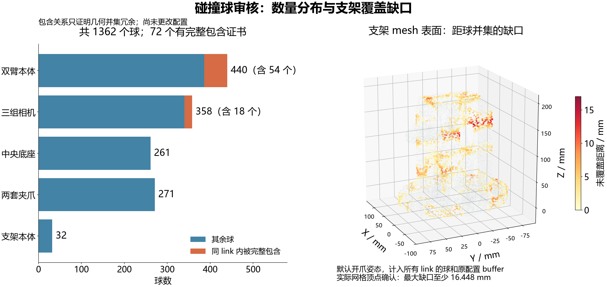

# 碰撞球审核（2026-09-30）

当前模型确实有 **1362 个球、38 个 link**。审核发现：同 link 内有 **72 个完整包含的球**；有些部位仍有覆盖缺口；相机和四片夹爪连杆占用大量小球。不能简单断言“所有球都太多”，也不能靠统一放大球解决。

本轮只读审核，没有改动碰撞球、URDF、skills、官方 SDK、算法镜像或容器，没有执行机器人动作。只新增本报告、图和数值证据。

## 1. 球数、来源与真正的集中部位

| 部位 | 球数 | 说明 |
|---|---:|---|
| 双臂本体（含 Base_L/R） | 440 | 左202、右238 |
| 两腕相机＋头部相机 | 358 | 左139、右118、头部101；含各自安装支架、外壳和窗口 |
| 中央底座 Link_Base | 261 | 底部网格148、中柱17、加强筋96 |
| 两套夹爪 | 271 | 左135、右136；其中四片 Link2 连杆各55，共220 |
| 支架本体 | 32 | 加上头相机101，Link_Stand 合计133 |
| **合计** | **1362** | 所有半径均为正，未把 disabled placeholder 算进去 |

358个相机球来自项目 `camera_spheres.py`：最长边不超过4 mm的小三角面，按15 mm网格分组，再用球包住整组小三角面。不是官方 MORPHIT 默认拟合。本轮内存重建得到139/118/101，逐项与YAML一致；9个相机OBJ在 base/JEV 内字节一致；现成相机CPU测试6项通过。

中央底座由 `central_base_spheres.py` 的规则生成。重建的261球也与YAML逐项一致。

YAML标头中的 `sphere_density=10`、700 iterations、coverage weight1000等参数，仅对应 `build_dual_robot_model.py` 对两个 **grip_Base** 的refit。机械臂和薄连杆保留源配置，相机和中央底座采用各自生成器。因此当前模型并非全部由同一套官方拟合参数生成。

## 2. 有严格证据的几何冗余：72球

在同一link中，若小球半径r、大球半径R、球心c/C满足 `R>r` 且 `(R-r)² > ||C-c||²`，小球完整位于大球内。

本轮对全部同link球对独立扫描，并对72条关系按原始YAML十进制值使用80位Decimal复核。每个被包含球都有一个**直接保留的包含球**，没有链式删除问题。完整0-based索引、球参数及证书在JSON的 `exact_containment.certificates`。

| 内存中仅移除这72球的比较 | 当前 | 比较值 | 减少 |
|---|---:|---:|---:|
| 球数 | 1362 | 1290 | 5.286% |
| 执行A、冻结B的潜在self球对 | 507540 | 444269 | 12.466% |
| 执行B、冻结A的潜在self球对 | 508106 | 445432 | 12.335% |
| 完整双臂原始矩阵 | 528112 | 461952 | 12.528% |

这些只是内存比较，**没有写出或启用删球后的模型**。同link的统一buffer和刚体变换在数学上保持包含关系，但几何并集相同，不等于cuRobo的soft cost、梯度、swept sampling、浮点归约与最终规划结果完全相同。

最小包含裕量只有0.000870 mm，float32参数转换后仍为正。该微小值不能被扩大解释为任意浮点运算下的碰撞等价证明。当前self kernel的A/B pair blocks删除前后仍各为4，不能把12.4%的球对降幅当成实测加速比例。本轮未跑替代模型GPU benchmark。

## 3. 比球数更重要的覆盖问题

先对每个link的详细visual mesh按面积采样20000点，并检查全部网格顶点；球心与网格均放在该link局部坐标系。再把机器人置于YAML默认双臂姿态、两个夹爪锁定0 rad开爪，合并所有1362个球，检查相邻link是否补上缺口。

**支架存在一个具体缺口证据：**

- `Link_Stand` 的详细visual mesh顶点，局部坐标 `(-60.000, -10.785, 163.894) mm`。
- 默认姿态下世界坐标 `(-60.000, -10.785, 1144.894) mm`。
- 计入全部link及原有world buffer后，该顶点到球并集仍有 **16.447827 mm** 的正间隙。
- 最近的是 `Link_Stand[23]`，它的球半径为26.375672 mm。

这表明当前球模型没有完整包住该处visual表面。它**不是**“整个模型最大误差只有16.45 mm”的上界，也不证明某条已有抓取轨迹发生了碰撞；但足以说明，当前 **10 mm hard clearance不能直接理解成所有实际机器人表面都保证10 mm净距**。该参数检查的是规划几何。

默认开爪姿态合并全机器人球之后，机械臂表面仍有毫米级缺口，夹爪部分连杆也仍有缺口。完整逐link数据见第7节。相机的全部顶点和本轮表面样本均被覆盖；这是表面检查，不能推断任何封闭实体内部都被球填满。

四片 `gripL/R_Link2_L/R` 的55球原始半径均为3 mm。原始球对其visual表面采样覆盖率仅约28.6%–29.4%，最大样本缺口约4.9–5.0 mm；加上已有5 mm world buffer后，半径为8 mm，本轮全部表面样本和顶点均被覆盖。其内部体积采样也从约29%–33%覆盖提升到本轮100%。这说明这些球强烈依赖buffer，不能只看55这个数字就直接精简。

## 4. 不能混淆visual实体与MuJoCo碰撞代理

79处mesh引用在JEV、tianji-simulation和base当前description之间逐字节一致，mesh scale全部为1。本轮没有发现JEV复制错网格或单位错误。

- **Link_Base：**当前collision STL是凸包，体积0.287465 m³；详细visual/原始STL约0.009958 m³。凸包填满四脚和立柱间的空隙。球未覆盖这些虚构的凸包填充面，不能说是真实底座漏包。
- **底座脚轮：**原底座生成器只审核局部z≥0。当前visual按此范围，本轮表面采样覆盖率98.893%，最大样本缺口8.679 mm；z<0的脚轮并未完整包覆，完整visual统计因此会出现约60 mm缺口。不能把该脚轮缺口冒充桌面工作区内立柱的缺口，也不能宣称完整底座均已覆盖。
- **grip_Base：**球基于详细夹爪外形；当前MuJoCo contact采用76×92×98 mm盒子。两个盒子的空角与详细外形不同。visual加现有10 mm buffer的本轮样本全部覆盖，但盒子表面只约59%覆盖，主要反映两种代理不一致。
- **TCP_Link_L/R：**包含相机visual和球，URDF没有collision元素。球审核应使用相机visual，不能漏掉visual origin或重复变换。
- `model_builder.py` 现有代码禁用了 `Link_Base/Link_Stand/Base_L/Base_R` 的MuJoCo contact，以避免凸包占据桌面工作区。这些部位仍出现在cuRobo球模型中。此差异是既有实现，本轮未修改。

因此应分别评价“球对详细外形的近似质量”和“规划几何与MuJoCo contact几何的一致性”。不能用一次仿真没有contact反证球模型完整。

## 5. buffer和度量口径

固定官方commit `8e734f3ced1df898990bcd92de40abce475907db` 的loader/kernel路径中：

- world有效半径 = YAML半径 + `collision_sphere_buffer`；
- self有效半径 = world有效半径 + `self_collision_buffer`。

当前非零world buffer恰好有对应的负self buffer：Link5为+5/-5 mm，Link7为+3/-3 mm，grip_Base为+10/-10 mm，四片grip_Link2为+5/-5 mm。因此这些部位的self有效半径回到原始YAML半径。10 mm hard clearance另行作用于场景距离，不是又一项固定写入YAML的球半径。

本轮CPU指标沿用官方定义的公式，但不调用SDK私有函数、不重新拟合：

- surface gap：`max(0, min_i(||p-c_i||-r_i))`；表面按三角面积采样。表面覆盖率是本报告附加字段，不是官方volume coverage。
- volume coverage：只对watertight、法向一致、体积为正的原始visual网格计算，内部点落在球并集中的比例；报告实际样本数。
- protrusion：各球等数量采样球面，统计mesh外点，到mesh的距离P95仅对外部点计算。它不是球并集外边界的面积加权误差；球间重叠和其他link可能影响实际意义。
- volume ratio是各球体积之和除mesh体积，重叠体积会重复计数，不能当成球并集体积。

非watertight网格不静默补洞、不改用convex hull，体积和有符号外凸指标明确标为不可用，仍保留表面缺口检查。所有采样统计都有采样误差；100%样本覆盖不是连续几何证明。

## 6. 处理优先级

1. **先修订并审核存在visual模型覆盖缺口的link拟合。**支架16.448 mm顶点证据优先；机械臂、夹爪需结合邻接关系和多姿态继续验收。不能通过统一放大球掩盖问题；本轮未测量真机外表面。
2. **把72条完整包含关系作为最明确的精简候选。**先审阅候选配置，再做相同输入、相同阈值的CPU几何和GPU规划回归；不承诺仅删72球就有明显提速。
3. **再评估三组相机358球、四片薄连杆220球的重新拟合。**比较较少球数下的覆盖、外凸、原有开爪几何及规划性能。不能套用官方某双臂示例的总球数，也不应取消相机或夹爪碰撞来求快。
4. **单独审查自碰撞ignore和冻结静态部分的重复计算。**这与几何拟合是不同问题。当前TCP对本侧多个gripper link有ignore；只有证明刚性关系或运动范围内不可能相碰后才能调整，随机几组姿态无碰撞不足以证明。

以上为审核建议，尚未实施任何模型变更。

## 7. 全部38个link的表面审核结果

下表“本link覆盖/P95/最大”使用world buffer和本link球；“整机最大”使用默认开爪姿态的全部球。最大值均为各自20000个表面样本中的最大值，不是连续上界；不同列独立采样，因此小幅数值差异不能解释成合并球后变差。全部顶点检查另存JSON。

| Link | 球数 | 被包含 | world buffer / mm | 本link表面覆盖 | P95缺口 / mm | 样本最大 / mm | 默认姿态整机样本最大 / mm |
|---|---:|---:|---:|---:|---:|---:|---:|
| Base_L | 1 | 0 | 0 | 87.37% | 3.494 | 6.600 | 5.938 |
| Base_R | 1 | 0 | 0 | 88.20% | 3.094 | 6.689 | 6.659 |
| Link1_L | 16 | 0 | 0 | 82.14% | 2.740 | 10.316 | 7.780 |
| Link1_R | 23 | 1 | 0 | 78.38% | 2.770 | 8.030 | 6.434 |
| Link2_L | 29 | 0 | 0 | 70.88% | 4.156 | 10.661 | 9.090 |
| Link2_R | 35 | 3 | 0 | 70.03% | 4.075 | 9.320 | 9.082 |
| Link3_L | 28 | 7 | 0 | 78.93% | 3.557 | 11.641 | 6.638 |
| Link3_R | 45 | 15 | 0 | 84.73% | 2.449 | 11.937 | 7.142 |
| Link4_L | 27 | 2 | 0 | 78.15% | 2.950 | 7.667 | 8.036 |
| Link4_R | 28 | 2 | 0 | 78.36% | 3.137 | 8.937 | 8.560 |
| Link5_L | 66 | 14 | 5 | 90.09% | 0.997 | 8.811 | 8.528 |
| Link5_R | 71 | 10 | 5 | 93.58% | 0.294 | 7.483 | 7.773 |
| Link6_L | 1 | 0 | 0 | 82.14% | 3.950 | 6.388 | 5.066 |
| Link6_R | 1 | 0 | 0 | 75.62% | 5.702 | 9.671 | 5.558 |
| Link7_L | 34 | 0 | 3 | 70.74% | 3.166 | 8.118 | 7.143 |
| Link7_R | 34 | 0 | 3 | 74.65% | 2.860 | 8.673 | 8.720 |
| TCP_Link_L | 139 | 10 | 0 | 100.00% | 0.000 | 0.000 | 0.000 |
| TCP_Link_R | 118 | 6 | 0 | 100.00% | 0.000 | 0.000 | 0.000 |
| Link_Base | 261 | 0 | 0 | 91.39% | 28.780 | 59.754 | 59.686 |
| Link_Stand | 133 | 2 | 0 | 77.58% | 5.052 | 16.013 | 16.225 |
| gripL_Base | 5 | 0 | 10 | 100.00% | 0.000 | 0.000 | 0.000 |
| gripL_Link1_L | 2 | 0 | 0 | 88.87% | 1.482 | 4.129 | 0.000 |
| gripL_Link1_R | 2 | 0 | 0 | 88.11% | 0.790 | 2.535 | 0.000 |
| gripL_Link2_L | 55 | 0 | 5 | 100.00% | 0.000 | 0.000 | 0.000 |
| gripL_Link2_R | 55 | 0 | 5 | 100.00% | 0.000 | 0.000 | 0.000 |
| gripL_Link3_L | 2 | 0 | 0 | 88.69% | 1.234 | 4.125 | 4.124 |
| gripL_Link3_R | 2 | 0 | 0 | 87.08% | 1.272 | 3.759 | 3.857 |
| gripL_Link4_L | 6 | 0 | 0 | 88.39% | 0.832 | 3.258 | 3.201 |
| gripL_Link4_R | 6 | 0 | 0 | 83.96% | 1.470 | 3.935 | 3.364 |
| gripR_Base | 5 | 0 | 10 | 100.00% | 0.000 | 0.000 | 0.000 |
| gripR_Link1_L | 2 | 0 | 0 | 75.83% | 1.468 | 3.433 | 0.000 |
| gripR_Link1_R | 2 | 0 | 0 | 83.41% | 0.948 | 2.741 | 0.000 |
| gripR_Link2_L | 55 | 0 | 5 | 100.00% | 0.000 | 0.000 | 0.000 |
| gripR_Link2_R | 55 | 0 | 5 | 100.00% | 0.000 | 0.000 | 0.000 |
| gripR_Link3_L | 2 | 0 | 0 | 86.64% | 1.413 | 4.350 | 4.400 |
| gripR_Link3_R | 3 | 0 | 0 | 87.06% | 1.080 | 3.652 | 3.698 |
| gripR_Link4_L | 6 | 0 | 0 | 90.84% | 0.753 | 3.048 | 3.032 |
| gripR_Link4_R | 6 | 0 | 0 | 86.47% | 1.047 | 3.616 | 2.701 |

Link_Base此表包含z<0脚轮。对于生成器定义的z≥0范围，应使用第4节和JSON中的above_floor字段。

## 8. 可用网格的内部覆盖与外凸采样

未列出的link原始visual不满足watertight/一致法向等条件，其体积/有符号外凸未计算。数值为**本link**、world buffer后。P95外凸条件为球面采样点在mesh之外；不能当成真实机器人外壳在世界中多出来的统一厚度。

| Link | 内部样本数 | 体积样本覆盖 | 球面样本数 | 外部点距离P95 / mm |
|---|---:|---:|---:|---:|
| Base_L | 10000 | 98.46% | 200 | 15.467 |
| Base_R | 10000 | 98.83% | 200 | 16.006 |
| Link1_L | 9765 | 97.42% | 3200 | 14.668 |
| Link1_R | 9838 | 96.73% | 4600 | 9.821 |
| Link2_L | 7438 | 92.32% | 5800 | 10.045 |
| Link2_R | 7714 | 91.74% | 7000 | 12.115 |
| Link3_L | 1455 | 95.46% | 5600 | 15.980 |
| Link3_R | 1560 | 97.56% | 9000 | 17.691 |
| Link4_L | 1454 | 95.05% | 5400 | 20.396 |
| Link4_R | 1463 | 94.26% | 5600 | 16.047 |
| Link5_L | 2023 | 98.81% | 13200 | 6.264 |
| Link5_R | 2063 | 99.13% | 14200 | 5.488 |
| Link6_L | 2481 | 98.75% | 200 | 14.180 |
| Link6_R | 2472 | 97.21% | 200 | 16.558 |
| Link_Base | 56 | 87.50% | 52200 | 55.135 |
| gripL_Link1_L | 1512 | 91.67% | 400 | 7.816 |
| gripL_Link1_R | 1542 | 94.55% | 400 | 5.977 |
| gripL_Link2_L | 501 | 100.00% | 11000 | 7.351 |
| gripL_Link2_R | 477 | 100.00% | 11000 | 7.329 |
| gripL_Link4_L | 316 | 93.04% | 1200 | 11.436 |
| gripL_Link4_R | 286 | 90.21% | 1200 | 11.497 |
| gripR_Link1_L | 1541 | 90.53% | 400 | 5.761 |
| gripR_Link1_R | 1485 | 93.54% | 400 | 5.472 |
| gripR_Link2_L | 467 | 100.00% | 11000 | 7.282 |
| gripR_Link2_R | 424 | 100.00% | 11000 | 7.296 |
| gripR_Link4_L | 301 | 93.36% | 1200 | 11.660 |
| gripR_Link4_R | 305 | 90.82% | 1200 | 11.790 |

内部点从包围盒均匀提议后按mesh内部筛选。首批link使用20000个提议、最多10000个内部点，其余使用4000个提议；实际计数见表和JSON。内部样本较少的薄壁部件不应依据百分比小数位比较拟合优劣。球面各球200点。Link_Base只有56个内部样本，不足以据此评价拟合优劣；该指标还包含完整visual及脚轮，与其生成器限定的z≥0目标不同，仅保留为原始观测，不作为通过或失败依据。

## 9. 证据与核验

- 完整数据：[collision-sphere-audit-2026-09-30.json](../data/collision-sphere-audit-2026-09-30.json)。
- 配置SHA256：`d7e627475865271a66bc785258dd59177080eb3a6e106cce26cb4465971421ae`。
- Windows JEV/base、Ubuntu JEV/base四处配置SHA256一致，审核后仍保持该值。
- 诊断公式通过单球距离、球包含关系、box有符号距离的解析校验。
- 相机现成CPU测试6项通过；未运行替代模型GPU benchmark，未对未知物理轨迹做安全保证。
- 同次性能分析：[planning-kernel-audit-2026-09-30.md](planning-kernel-audit-2026-09-30.md)。性能瓶颈证据与本几何审核应结合使用，不能仅凭球数归因全部耗时。

官方参考（固定commit）：

- [Sphere fitting说明](https://github.com/NVlabs/curobo/blob/8e734f3ced1df898990bcd92de40abce475907db/docs/reference/sphere_fitting.rst)
- [指标定义](https://github.com/NVlabs/curobo/blob/8e734f3ced1df898990bcd92de40abce475907db/curobo/_src/geom/sphere_fit/metrics.py)
- [球半径加载](https://github.com/NVlabs/curobo/blob/8e734f3ced1df898990bcd92de40abce475907db/curobo/_src/robot/loader/kinematics_loader.py#L848-L915)
- [self collision padding](https://github.com/NVlabs/curobo/blob/8e734f3ced1df898990bcd92de40abce475907db/curobo/_src/curobolib/kernels/geometry/self_collision/self_collision_helper.cuh#L155-L183)
