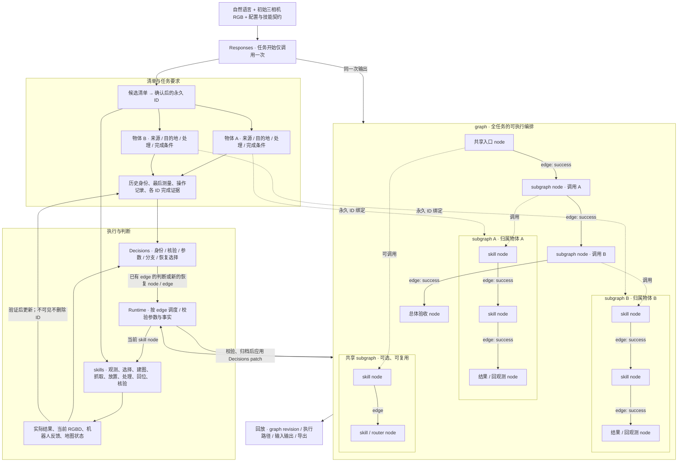

# GaP 源码对照与清单扩展

核对日期：2026-10-29。只读核对的版本：

- graph-as-policy：`71549e1584839337eb355c280e7b1e50c805b8c7`
- open-robot-skills：`752dfbd96968d4d08379f8111765efbf6457800b`

这是源码分析，不是声称我们复现了官方 benchmark 的成绩。用户截图和当前主分支示例存在版本差异；截图里的 `plan/execute` 不能直接当作当前 grocery packing 的调用路径。

## 统一概念与整体图

任务编排就是 Responses 生成的可执行 graph，不是 graph 之外的第二套流程。清单回答“有哪些实体，各自要完成什么”；graph 回答“何时调用什么能力，如何根据结果继续”。二者是相关的数据与控制结构，不是互相替代的两个最高层。

同一次初始 Responses 请求输出候选清单、每个物体的任务要求、graph。生成时用自己输出的实体 ref 相互引用；程序随后一致地分配永久 ID。不是先调用 Responses 建清单、再调用第二次 Responses 编排。TaskSpec 只是任务要求的数据类型名称，不是另一套编排。

下图中的物体数量和连线仅用于解释结构；真实 node、edge、顺序及恢复分支由归档 graph 决定。物体 subgraph 和共享 subgraph 都是同一种可执行结构，前者额外绑定清单 ID 和独立任务要求。

skill 是能力；node 是本次任务对能力的一次调用。多个 node 可以调用同一 skill，传入不同 ID 和参数。subgraph 是一组 node/edge 的命名边界，可以表示一个物体的完整工作，也可以封装共享工作；不是“有两个物体就只能有两个 subgraph”。本项目禁止递归调用及物体 subgraph 内再嵌套另一个物体所有者，避免任务归属泄漏；允许调用共享 subgraph。

Decisions 不需要预先穷举所有失败。原 graph 没有处理某个 skill 的 failure/unknown 时，runtime 请求 Decisions 选择当前前提成立的注册能力和参数，将选择变为新的 node/edge，先校验和归档再执行。它不运行任意代码、不改变目标、不重播已完成的物理动作。当前证据下已拒绝的操作参数组合会退出该轮可选集；这不替模型指定另一条路线。

恢复能力成功后，对声明可安全重试的原 node，先用一个聚焦的 Decisions 选择判断“重新核验原 node 并接回原 graph，还是仍需其他恢复”。只有模型选择重新核验才产生回到原 node 的 edge；原 node 的所有检查仍完整执行。这样把控制续接与二十余种能力选择分开，避免已经补齐证据却反复选择观测。它不是 runtime 自动认定原 node 成功，也不是插入固定技能流程。

## SAM3、多提示词与永久 ID

1. Responses 给出物体描述、分割主提示、少量外观别名以及某个相机的参考框。参考框表示初始语义指向，不是精确掩码、3D 尺寸或永久视觉跟踪器。
2. observe_scene 在冻结的当前三相机 RGB 上调用 SAM3，使用短外观提示；主提示与别名使用英文视觉短语；掩码为空才补充有界颜色描述，容器也可尝试 color box / color container。SAM3 输出像素掩码和分割分数。候选框是掩码的外接矩形，用来展示该掩码覆盖哪个视觉区域。
3. 同相机、相同物体类别与请求颜色下，掩码 IoU ≥ 0.95 的近重复候选合并，并保留所有提示词来源。不同相机的像素不能用这个 2D IoU 规则直接合并。
4. Decisions 查看当前 RGB、初始参考、候选标注、清单与已验证历史，判断候选对应哪个永久 ID，或 reject/unknown。不同提示词得到的两个掩码不会仅因为有两个结果就创建两个 ID。
5. 已确认属于同一 ID 的多视角掩码经标定 RGBD 获得该 ID 的当前几何，供 GraspGen 和 TSDF/ESDF 使用。清单数量来自确认的物理实体身份，不是提示词成功次数，也不是掩码数量。

仍有风险：明显不同的掩码可能来自同一物体的局部或部件，IoU 去重不能解决所有语义重复；Decisions 也可能误关联。不能把此规则说成“绝不会重复”。模糊候选不进入几何，初始清单需完整性核验，已冻结清单的后续部分观测可以保留已确认子集，并明确列出缺失 ID。缺失不删除历史实体，也不自动授权运动。`0.95` 是几何去重门槛；Decisions 的身份概率门槛、SAM3 自身分数与它是不同量，不能混称置信度或随意一起降低。

## 官方 grocery packing 实际如何工作

对应[官方 README](https://github.com/graph-robots/graph-as-policy/blob/71549e1584839337eb355c280e7b1e50c805b8c7/examples/grocery_packing/README.md)及[可执行 workflow](https://github.com/graph-robots/graph-as-policy/blob/71549e1584839337eb355c280e7b1e50c805b8c7/examples/grocery_packing/packing_graph/workflow.json)。

| 问题 | 当前官方示例的实际实现 | 对本项目的意义 |
|---|---|---|
| 是否能逐个处理多个物体 | `perceive_next → grasp → transport → perceive_next` 共享循环 | 它已有多物体顺序搬运能力；我们的区别是永久清单 ID 对应独立任务和独立 subgraph，而非首次发明逐个搬运 |
| 先抓哪个 | 每轮感知选择下一个符合描述的目标；不是默认把所有物体预先排成最优全局序列 | 本项目可以初始按每物体要求安排顺序，后续由合法 edge/恢复选择处理证据变化；当前没有宣称最优调度 |
| 怎么知道物体在哪 | Grounding DINO 广泛检测，VLM 裁剪候选比较，SAM3 分割，再用深度和标定得到世界点云 | 视觉定位也依赖标定与深度，不是仅靠自然语言 |
| 怎么知道尺寸 | 从分割点云拟合 OBB | 来自可见表面估计，不是知道全部真实尺寸 |
| 是否使用 GraspGen | 此示例主要使用 OBB 顶抓几何候选 | 不能说它已验证任意形状物体抓取；本项目的学习型抓姿生成有价值 |
| 是否批量 IK / BatchMotionPlanner | 默认快速抓取路径使用定向直线/笛卡尔移动；失败时遍历抓姿。通用包装器有 goalset `plan_pose`，不等于多实例 BatchMotionPlanner；v0.8 的独立 batch feasibility 入口标为不支持 | 不应因 API 名字或仓库中存在某函数，就断言 demo 使用它 |
| 碰撞场景 | 通用 build_world 从深度点云去机器人表面、提平面与聚类，生成薄片/簇网格；可按掩码去目标 | 不是 TSDF/ESDF；不替换我们已明确的地图方案 |
| 快速直线抓取是否完整避障 | directed planner 的快速配置不使用环境碰撞，相关自碰撞检查也关闭 | 速度不能与本项目保留完整检查的路径直接比较；不照搬这个取舍 |
| 携物是否 attachment | API 库有 attach 包装，但此 packing 默认 transport 脚本未调用它 | 不能借该 demo 证明带物体避障已经解决 |
| 每次是否回固定观测位姿 | 放下后开爪并竖直撤离，停在篮子上方，随后重新感知；没有每次 go_home | 用户要求的双臂固定观测位姿是本项目新增明确任务条件 |
| benchmark 有何简化 | README 明确送达对象会被移出场景；停滞/循环预算的退出语义也需谨慎 | 不把其“结束”直接等价于我们的全部清单逐项完成证据 |

关键源码：[感知脚本](https://github.com/graph-robots/graph-as-policy/blob/71549e1584839337eb355c280e7b1e50c805b8c7/examples/grocery_packing/packing_graph/scripts/perceive_dino_vlm.py)、[抓取脚本](https://github.com/graph-robots/graph-as-policy/blob/71549e1584839337eb355c280e7b1e50c805b8c7/examples/grocery_packing/packing_graph/scripts/grasp_move.py)、[运输脚本](https://github.com/graph-robots/graph-as-policy/blob/71549e1584839337eb355c280e7b1e50c805b8c7/examples/grocery_packing/packing_graph/scripts/transport_move.py)、[释放与撤离](https://github.com/graph-robots/graph-as-policy/blob/71549e1584839337eb355c280e7b1e50c805b8c7/examples/grocery_packing/packing_graph/scripts/place_release.py)、[几何工具](https://github.com/graph-robots/open-robot-skills/blob/752dfbd96968d4d08379f8111765efbf6457800b/tools/geometry/_impl.py)、[cuRobo 包装](https://github.com/graph-robots/open-robot-skills/blob/752dfbd96968d4d08379f8111765efbf6457800b/tools/curobo/_curobo_impl.py)。

不要混淆 grocery packing 和 grocery fulfillment：后者有按描述选择目标、LLM 生成 graph 和仿真真值 checkpoint 的另一套实验设置。真值评分不等于把真值用作实际视觉输入。

## OBB 与 attachment

OBB 是 Oriented Bounding Box，即能随物体方向旋转的包围盒。它用中心、方向和尺寸概括点云。上述几何实现投影 XY、拟合平面最小宽度矩形，使用 2%/98% 分位范围，Z 保持竖直；`extent` 是半尺寸。这不是恢复任意倾斜物体完整外形的通用方法。

OBB 对盒状物体的抓姿初始化、粗尺度判断便宜且实用。只看到顶面可能低估高度；轮廓和背景误分可能高估；凹物体内部空隙被填成实心盒子。OBB 的准确程度取决于可见表面、分割、标定和拟合假设，不是名称本身保证的。

attachment 把携物几何放到机器人运动链中一起做碰撞检查，不会让机器人在物理上“自动碰到”东西，但几何高估会产生虚假碰撞，低估会漏掉实际碰撞。若原世界里的目标没有正确去除，还会与自己的旧几何重复碰撞；若变换坐标系或夹持链接例外设置错误，也会立即自碰撞。这些都不能用统一降低阈值解决。

本项目保留：真实抓姿来自 GraspGen；碰撞实体用实测 TSDF/ESDF，桌面用实测 cuboid；lift 完成后建立实测表面 attachment。按此前用户批准，首次 lift 没有携物扫掠体积检查，这个限制仍需明确。当前表面 attachment 也受遮挡影响，不能宣称恢复了不可见的完整物体。

## 采用的架构与没有声称的等价性

### 追加核查：结构已经相似，隔离尚未完成

不能把“目录里有 core/agent/runtime”说成整个仓库已经和 GaP 同等清晰。当前真实调用链仍是 `PolicyController(RobotOperations)` → `RobotOperations(..., Runner)`；controller 1465 行、Runner 1377 行，算法适配器也有千行模块。它们共享 context/facts 并通过继承组合感知、动作、模型核验和任务账本。`demo_sampling`、`demo_transfer_verification` 等模块仍被当前 skills 引用，部分名称遗留，部分职责仍需拆分。仅改名、移动目录不能完成隔离。

| 边界 | 已实现 | 尚未等同于官方 GaP |
|---|---|---|
| 控制结构 | 显式 graph/subgraph/node/edge；native executor 依 edge 推进；subgraph node 调用具名定义 | 本项目 v2 是顺序异步执行协议，不是官方 v3 的完整调度/端口协议 |
| 模型与执行器 | core 无模型/机器人调用；executor 注入 invoke/judge/propose_recovery | 上层 controller 仍继承机器人 operations，尚未完全改为独立接口组合 |
| skills | 注册契约、Description/Inputs/Outputs、有类型 arguments、前提与效果 | outputs 主要是证据名称和字典，不是官方全部类型化 data ports；仍共享大 context |
| 清单扩展 | 永久 ID、独立 TaskSpec、owned subgraph、独立完成账本 | 这是本项目有意扩展，不能因追求目录一致而删除 |
| 兼容逻辑 | 正式入口额外 Responses 预算为零，选择 GraphInitialPlan，只接受 v2 | controller/schema 中仍有兼容库分支，历史 steps 不是已全部删除；生产不会自动回退 |
| 可视化 | 读取归档 graph、来源和每次调用事件 | 源 graph、可能 edge、执行 trace 是不同证据，不能把全部画成同一种线 |

本次复现了 controller 在 router 得到 unknown 时先抛异常、跳过已有 unknown edge 的缺陷。修复保持 unknown，不将其当 yes 或任务成功。图未预写该结果时，恢复能力也由 Decisions 选择；补证据后可以重新判断 router，不由代码插入观测流程。

### 图中很多线是否代表反复执行

截图对应 `a150686f6a4f47a48bba9c158b970c34`：绿色 identify_target 返回 `observed_support_current_geometry_required`，进入一次恢复 router，Decisions 选择一次 build_scene，随后程序异常，没有该 node 的结果事件。新增 2 node / 5 edge，但绿色只有三次 node 进入记录（identify_target、recovery、build_scene）。三条可能返回 edge 没有执行，不能画成三次尝试。

另一个归档 `41eb6015ac6a4f378994f6e89fb1dded` 确有 22 次 patch，全任务 63 次 node 进入，包含反复恢复。它发生在缺少部分身份澄清和恢复续接判断的旧版本。新界面保留每次访问、时间、来源、结果及实际 edge，不能用节点去重掩盖重复。

Runtime 自动写出的 success/failure/unknown 返回路由属于执行机制；Decisions 选择恢复 skill、参数或重试对应 selected edge。不能因整个 patch 标了 source=decisions，就说三条假设结果全部由模型设计或执行过。

### 放置位置及稳定性的准确结论

Responses 选择目的实体/区域引用；identify_destination 绑定该引用的测量或配置；plan_place 根据该区域、物体几何、可达与碰撞约束求具体候选位姿。粉色要求的是控制台区域；绿色可选实测桌面，也可选配置桌面区域。最近成功记录 `949fe60a2481470782aa2ae4820ba991` 选择了 demo-destination，它与 vla-unpack-input 当前共享界面 XY/边长，所以绿色也被限制在该区域。两个别名仍是配置债务。

相同初始画面并不固定 Responses graph、Decisions 关联、GraspGen 采样、规划轨迹和物理反馈；但模型随机性不能为程序异常、证据未传递和分支被异常截断开脱。历史失败分别存在这些不同原因。各轮又包含代码修复，不是同一版本的重复试验，不能据此算稳定成功率。此前完整成功记录只证明该版本该次双物体搬运通过，不能证明所有恢复分支或任意抓放已可靠。

官方分离 `gap-core`、runtime、agent、skills registry、connector 和 viz。本项目相应分层为：

| 本项目 | 职责 |
|---|---|
| `core/graph.py`、`core/topology.py` | TaskSpec、graph/subgraph/node/edge 类型及纯结构约束；无模型或机器人调用 |
| `agent/` | 初始 Responses 协议、Decisions 请求、恢复选择；引用 core 类型 |
| `runtime/native_graph.py`、`runtime/validation.py`、`runtime/execution_state.py` | edge 调度、契约校验、作用域、执行状态、patch 与事件；执行器不继承旧 steps 遍历器 |
| `runtime/inventory.py` | 永久身份、每项任务要求、几何证据与完成账本 |
| `skills.py`、`skill_catalog/` | 注册能力与 Description / Inputs / Outputs、参数、前提、效果、错误 |
| `robot_skills/` 与算法/机器人适配器 | 能力实现及外部算法接口 |
| `web/src/replay-graph.js`、`replay-policy.js` | 读取归档 graph，显示与导出；不根据执行记录反推编排 |

当前显式 graph 是本项目 version=2 协议，不宣称可直接喂给官方 version=3 executor。2026-11-03 已删除旧 steps 的绑定分支、前端阅读器及专属兼容测试；旧实验仅保留原始 JSON。借鉴分层和图执行语义，不照搬官方多 agent 编写流程、关闭碰撞的快路径或仿真 benchmark 的对象移除机制。

21 个已注册 skills 的文档统一包含 Description、Inputs、Outputs，机器契约统一使用 `outputs`。输入参数有类型 schema；outputs 当前是能力结果/证据名称，不应伪称已实现 GaP 全部类型化 output-port 协议。每次新实验归档当次 skill 契约；旧实验缺契约时明确缺失，不用新契约冒充。

## 当前任务落点与实验边界

粉色物体的最终区域是用户配置的不可见 VLA 输入正方形，中心 XY 与边长由控制台提供；技能可在允许区域内求解，不必选中心。绿色物体要求放到桌面：Responses 可以引用实测桌面实体，也可以选择配置中的桌面区域。实测双物体第 20 轮选择的是 demo-destination；它当前与 vla-unpack-input 使用相同的界面 XY/边长，所以该轮绿色被约束在这片区域，不能说是在整张桌面自由选点。其他轮曾选择实测桌面实体。没有按绿色颜色硬编码落点，但配置区域会影响模型选择。放置规划在所选目的实体或区域的实测可用范围内求解具体姿态。得到目的实体不等于已经完成了具体放置姿态规划，必须分别查看 identify_destination、plan_place 和执行回执。

2026-10-29 新增的每物体回观测位姿要求写入 `resources/workcell_assumptions.json` 的 `completion_requirements.after_each_object`，传给 Responses。每物体成功出口检查相应姿态与观测事实，并将绑定输入 ID、观测 ID、实际双臂关节反馈及 action epoch 的历史凭据写入清单，供最终 Decisions 核验；runtime 不插入补动作。最终仍核验双臂回任务开始位姿。

本轮实验的真实结果和剩余问题以 `docs/native-graph-validation-20261029.md` 为准。已有粉色实际抓取、放置、核验成功不等于双物体任务通过；不得用单元测试替代绿色物体的实际抓取验收。
