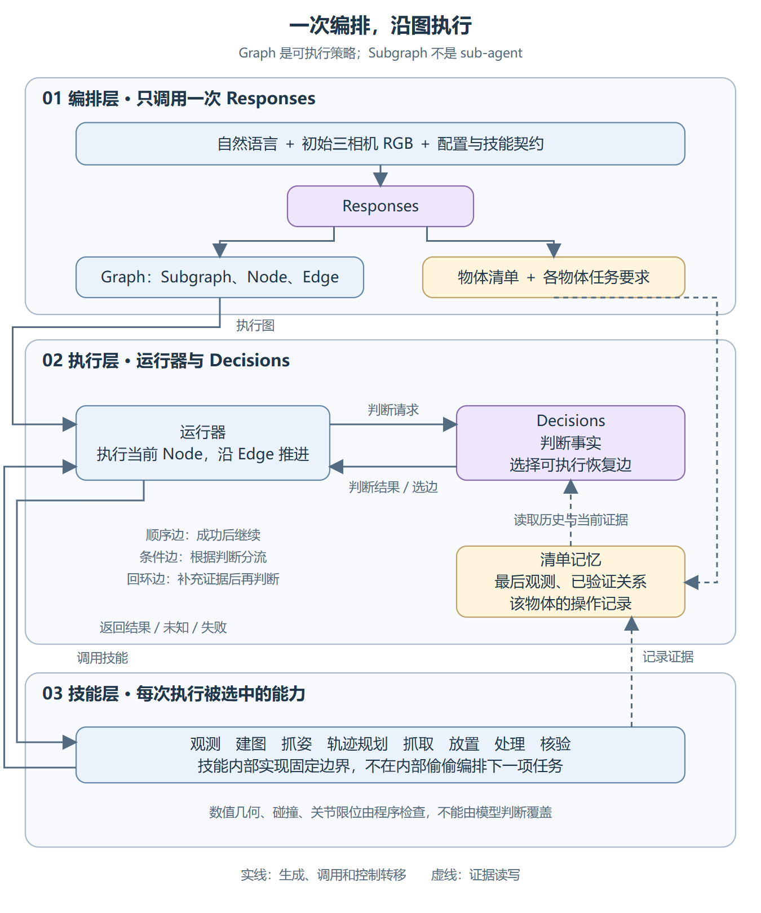
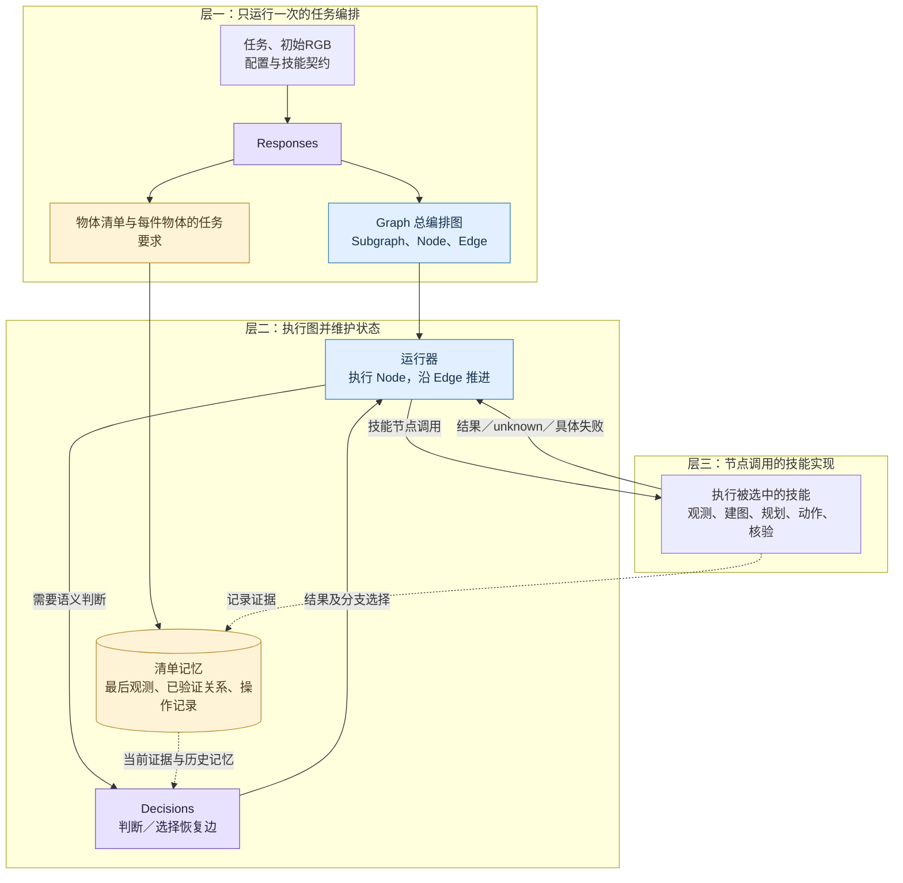
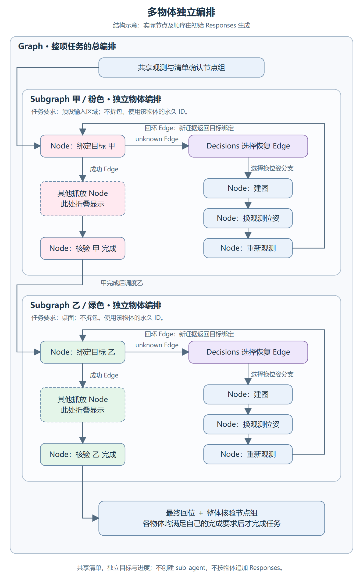
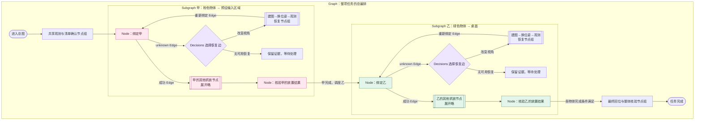
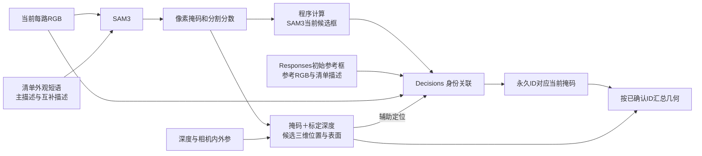

# Graph、Subgraph、Node、Edge：当前项目的控制层级与记忆

**版本说明：以下为之前 steps 实现的历史讲解。当前代码已经迁移至显式 graph/subgraph/node/edge，且 Decisions 可以生成新的恢复路径。请阅读 [当前实现与两张层级图](native-graph-implementation.md)；以下图片不代表当前生产 schema。**

本项目借鉴 Graph-as-Policy 的可执行图思想，不使用 GaP 的多智能体生成流程，也没有移植其原生运行器。当前运行入口只允许一次初始 Responses 请求；执行期间使用 Decisions 判断与选择已编写的分支。图生成失败不会自动增加 Responses 请求。

官方参考：[GaP 概述](https://graph-robots.github.io/graph-as-policy/docs/index.html)、[运行器规范](https://github.com/graph-robots/graph-as-policy/blob/main/docs/runtime.md)。官方图格式显式包含 nodes、edges、conditional_edges、subgraphs；本项目目前用 steps、if、recover 等结构表达这些控制关系，不能声称是相同 JSON 格式。

| 术语 | 本项目含义 | 当前代码表达 |
|---|---|---|
| Graph：总编排图 | 整个任务可执行的控制策略 | PolicyGraph |
| Subgraph：物体编排子图 | 某个输入物体及其产物的独立编排 | object_task.body |
| Node：节点 | 一次技能调用或一次控制判断 | skill、if、recover 等节点 |
| Edge：边 | 下一步控制转移，可带条件或形成循环 | 步骤顺序、if 分支、recover 的选择和返回路径 |
| 任务要求 | 物体的来源、目的地、处理要求与完成条件，不是动作节点 | TaskSpec |
| 物体清单 | 稳定身份、当前证据、历史观测、操作记录与完成账本 | inventory / task_progress |

使用中英文完整对应名称，不再把“策略图”作为额外概念。一个物体子图不是一个 sub-agent；当前各子图共用同一个运行器和机器人，按总图调度。GaP 官方的技能子图与这里按物体组织的子图也不是同一粒度：这里按物体组织是本项目为清单需求做的适配。

## 图一：控制层级

这张图只说明职责，不把 SAM3 的像素处理细节塞进控制层。虚线为证据读写，实线为控制或调用。

展开控制关系的 Mermaid 概念源

图是策略：同一个节点返回成功、未知或失败时，可以沿不同的边继续，而不是照固定步骤表执行。数值碰撞与关节检查不交给模型投票；所有换位姿动作仍须图中显式节点及合法运动前提。当前初始原始图像是启动输入，之后的任务技能由图控制。

## 图二：多物体独立编排

下面是结构示意，不是替 Responses 写死的任务模板。为了看清层级，只展开每件物体的目标绑定、恢复分流和结果验收；中间的建图、抓姿、抓取、放置节点明确折叠，不能将折叠框误认为单次技能调用。

展开多物体图的 Mermaid 概念源

两件物体可以有不同目的地、处理条件、抓取参数和恢复分支。总图选择先后顺序；甲完成不意味着乙完成；拆包产物通过输入—产物关联继承对应输入的任务要求。没有单独启动的物体 agent，也没有每件物体再调用一次 Responses。

图中的恢复边只有被 Responses 写进当前图后才能执行；示意图不代表每次模型都完整生成，也不代表该路径已经实测通过。真实图和实际执行分支保存在实验归档中。

## 图三：观测节点内部的数据处理

这是技能内部数据流，不是另一套任务控制器。

SAM3 收到图像和文本短语，返回掩码；程序计算候选框。Responses 初始参考框是历史定位提示，不是 SAM3 的分割边界。Decisions 负责对应身份，不绘制像素掩码。只有之后总图调用建图／抓姿节点，才把对应实测几何送入 TSDF/ESDF／GraspGen。

## 绿色物体：保留记忆与获得新证据是两件事

此前清单已经保留绿色物体初始来源证明，但支撑判断只收到了当前像素和当前几何，未收到那份已验证的历史关系。当前改为同时提供：

1. 原始 Decisions 来源关系证明，保留原 observation_id 和 request_hash。
2. 最后观测位置、最后观测时刻、当前是否可见。
3. 该物体后续的抓取尝试、转移记录和当前状态。
4. 当前 RGB 与当前身份绑定的实测几何。

模型可据此判断关系是否连续，而不是把暂时出画解释为之前的信息失效。初始参考框和未经核验的描述仍只是提案。历史信息不会改写时间戳冒充新观测；操作或矛盾证据可能使旧位置失效。当前抓姿和运动仍需要对应的几何、地图与数值检查。

identify_target 是无物理动作、可重试的绑定能力，现在可作为 recover 的 attempt。未知结果可以由 Decisions 选择图中已有换位姿分支。程序不在该技能内部偷偷移动，也不自动为模型补一个恢复图。

完整日志和真实验证结果见 [本轮验证](graph-memory-validation-20261029.md)。
