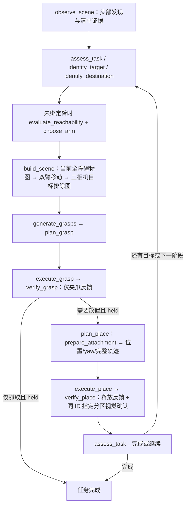

# JEV skill 使用与实现手册

本文件按当前 [Registry](../src/jev_mujoco/skills.py)、[16 份 contract](../skills/) 与 [runner 执行分支](../src/jev_mujoco/runner.py) 说明机器人实际可调用的技能。最近核对：2026-10-18。本轮以精简流程为准；最新故障、性能测量边界与验收见[当前验证记录](current-failure-validation-2026-10-16.md)，前次部署见[2026-10-15 记录](scene-opt-validation-2026-10-15.md)。

2026-10-16的只读审查记录了当时的反馈新鲜度、分组数量、实例去重、成员名额、IK 等待时限和提示一致性问题；详见[物体清单、ID 与 questions / skills 审查](identity-and-skill-audit-2026-10-16.md)。下文的职责与验收约束不能视为这些边界已经全部满足；该审查未更改或部署运行代码。

以上审查对应实施前d88b95f基线。本文当前流程已同步候选仓库的身份代码清理；本次清理未做新的在线Decisions、GPU搬运或发布验收，文末历史实跑结果不证明本次改动已上线。

## 当前流程与证据边界

JEV 在 skill 外选择任务成员、目标、阶段执行臂、目的地、下一技能、每次 Decisions 调用及用途和恢复；skill 内执行有界固定算法。一次调用为“契约校验→外层参数选择→skill_start→固定算法→skill_complete/skill_error”。内部阶段不再请求 JEV。所有 16 项及 stop 始终提供给 JEV，程序执行前校验所选入口，连续 8 次契约选择拒绝进入 needs_attention。

启动时的 bind_request 是 skill 外的指令理解。quantity 只提取原文明示的搬运数量；颜色、形状、来源区域不隐含数量为 1。“搬绿色物体”保留 requested_count=None，随后由 assess_task 按观测、来源和原文确认成员；这不授权搬走无关物体。“搬一个”明确计 1，多组明确数量可相加，同一个目标中转多次仍只计 1；不累加容器、障碍、编号或动作次数。没有字面数量候选时不询问 quantity、不设置数量门槛，数量由后续实际观测和任务成员清单决定。有字面数字/数词（含单个、a/an/single）时，仍由 JEV 区分目标数量与盒子、环境、步骤中的数字，置信度门槛保持配置值（默认 0.60），未达标不猜测、不自动重试。错误结论记录字段、返回值、实际置信度和门槛；bind_task 失败明确说明尚未开始观测或运动。

| 证据 | 含义与版本 |
|---|---|
| 当前观测 | 本次 RGBD、SAM3 掩码、实测表面及 capture/observation_id；相机外参不提供遮挡背面深度 |
| 任务清单 | 原指令确认的 required/excluded/unknown 成员、固定 ID/编号、完成与暂缓记录 |
| 碰撞场景 | 已发布 scene token、输入帧与冻结参数；非任务物体仍可作为障碍 |
| 夹爪反馈 | 当前 robot_snapshot 的命令/位置及 feedback_id；反馈不是新的 RGBD 帧 |
| 持物记录 | 已绑定历史目标、抓前可见点云及闭合时实际 TCP；verify_grasp 确认后保存地图，plan_place 才准备 attachment |

初次 observe_scene 仅使用头部提供清单证据，清单确认后以该帧建立包含全部物体的运动图。已有场景时，更新一律使用当前位置的三相机RGBD。放置及空爪撤离完成、反馈确认释放后，verify_place每次采三相机确认去向（包括最后一个）；若仍有搬运阶段，再以该帧更新全障碍物图，刚放物体和下一抓取目标均不排除。此后build_scene复用这份当前全障碍物图，先规划并复核双臂到观测位姿，再采三相机精建图，仅在该抓取图中排除当前目标。若尚无有效全障碍物图，先在当前位置三相机更新，再允许任何观测位姿运动。桌面cuboid只由初始头部建立，后续复用；更新仅重建SAM3实体。

execute_grasp/execute_place 不再采结果 RGBD。verify_grasp 只读夹爪反馈，不创建 attachment；plan_place 开始独立记录 prepare_attachment 阶段。verify_place先记录释放feedback_id，再以放后三相机确认去向；完成需要绑定同一释放阶段及目的地的当前observation_id。standalone place 只接受同 generation 的已验证持物，复用其保存观测/地图与执行臂，开始规划不额外拍RGBD，放后仍视觉确认；持物源绑定从已保存抓前scene_observation恢复，后续持物观察中被遮挡不丢失源对象，这份实测地图不用于推断当前身份或补点云。同时保存/恢复初始视觉参考与固定全清单，进入plan_place才准备attachment。



图示为依赖关系；通常异常、未知和恢复由 JEV 决定。observe_scene/build_scene 的固定清单身份缺失或歧义直接保留原错误及关联证据，以 needs_attention 结束本轮，不反复 recover。三视图使用证据并集，不要求每路都看见所有物体。每个搬运阶段只绑定一个执行臂；盒子→桌面→另一盒子保留同一 ID，进入第二阶段才可重新选臂。用户指定臂直接遵守。完整清单冻结后按初始头部图像行列分配编号，后续不重排。颜色、形状、编号或来源只限定任务成员，不单独构成执行顺序；“红色和绿色物体”默认 inventory，按未完成成员的编号升序选择。只有明确要求物体间先后（如“先绿后红”“从远到近”）才是 explicit，由 JEV 按原文选择；同一物体的盒→桌→盒路线阶段不是物体间顺序。

## 全部 16 个运行时技能

| Skill | 目的 |
|---|---|
| [observe_scene](#observe_scene) | 初始头部场景发现与清单证据 |
| [assess_task](#assess_task) | 任务成员与进度 |
| [identify_target](#identify_target) | 绑定本轮目标 |
| [identify_destination](#identify_destination) | 绑定目的区域 |
| [evaluate_reachability](#evaluate_reachability) | 离线中心可达性 |
| [choose_arm](#choose_arm) | 绑定阶段执行臂 |
| [build_scene](#build_scene) | 每轮完整抓取准备 |
| [generate_grasps](#generate_grasps) | 生成抓姿候选 |
| [plan_grasp](#plan_grasp) | 规划抓取三段 |
| [execute_grasp](#execute_grasp) | 执行抓取 |
| [verify_grasp](#verify_grasp) | 夹爪反馈持物判断 |
| [plan_place](#plan_place) | 准备持物碰撞与放置规划 |
| [execute_place](#execute_place) | 执行释放与撤离 |
| [verify_place](#verify_place) | 释放反馈与同ID指定分区视觉确认 |
| [inspect_scene](#inspect_scene) | 已有图像语义辅助 |
| [recover_task](#recover_task) | 执行显式恢复选择 |

### observe_scene

**目的与调用时机：**首次头部观测建立固定的全部物体清单，并提供搬运成员证据；后续更新原ID的可见性、测量和搬运位置证据。

**输入与前提：**observed=false；当前RGBD、自然语言任务、初始参考图、固定scene_entities、搬运清单及外层JEV选定的visual_plan。没有场景时仅分析头部；已有场景时使用三相机，任意一路可提供某个物体的证据，不要求三路同时看见。

**固定算法：**首次用头部RGB和完整指令调用Responses Structured Outputs，输出桌面实体、外观、初始RGB框、父容器、SAM3描述及required/excluded/unknown成员。程序分配固定全局ID，搬运清单引用同一ID。随后SAM3按清单描述分割；它不接收全局ID。Decisions以初始及当前完整RGB、初始ID参考图和当前临时候选框标注图（不生成或发送逐实体RGB裁剪），把候选关联到固定ID，独立判断各实体可见性和搬运去向。程序按返回的ID归并各相机掩码/点云。只向模型发送RGB及语义任务状态；深度、掩码轮廓和世界坐标不发送，目标区域仅提供本地投影的二维标注。初始清单不依赖SAM3成功与否：缺少掩码或有效深度的实体保留身份，标记geometry_status=missing / mapping_unresolved，阻止发布不完整碰撞图。最后一次视觉验收无需为无后续运动强行补全地图。初始RGB框不能冒充后续当前框。后续只复用固定清单的描述，不枚举类别和同义词。像素归并仅整理几何，不决定身份；同相机重复像素不重复计数，盒子不吞并已识别内容物的像素。桌面cuboid只建立一次。

**输出与状态：**observation、inventory_ready、visual_inventory（身份、初始成员、当前去向、模型/耗时/用量/观测ID）。成员证据写入TaskProgress；JEV仍决定技能、目标、数量分组与路线，不得覆盖明确视觉成员证据。完整清单仍经assess_task校验、编号和冻结。此技能不建图、不移动。

**视觉接口输入边界：**Responses仅接收初始头部RGB、用户指令及清单生成要求；Decisions接收初始/当前完整RGB、初始固定ID参考框图、当前临时候选框图，以及固定清单、候选SAM3描述和搬运状态。两接口均不接收SAM3像素掩码、掩码轮廓、深度图或点云；Decisions的候选框是本地从掩码计算出的二维外接矩形，目标分区是本地几何投影的二维标注，不是原始掩码或深度输入。身份问题只允许固定实体ID、reject（无关/清单外主体）和unknown（身份无法区分）；不再询问或接受invalid_mask。容器框包含内容物不影响按容器主体关联。掩码尺寸、有效深度、像素归属及碰撞几何完整性仍由现有本地流程检查，这不等于已证明SAM3每个像素的语义正确。

**数值与失败：**两接口均为官方gpt-6-luna。首次/v1/responses使用严格JSON Schema（1–64个可见实体，最多6000输出token，reasoning=low）；不把结构正确等同视觉准确。每次/v1/decisions最多200个封闭问题、128张图，choice confidence至少0.8，否则unknown；身份错误证据同时记录candidate、camera_id、模型原始choice/confidence及minimum_confidence，保留完整answers。默认超时60秒；同capture同输入的成功和错误均缓存，不自动HTTP重试或回退旧RGBD关联。Responses结构/服务失败、Decisions未知身份/服务失败都保留证据，needs_attention停止，不自动recover。不可区分的同外观实体不强猜ID。

正常RGBD预算2G+1（初始头部1、每轮抓前三相机G、每轮放后三相机G），G=冻结required数量×阶段数；恢复采集独立8次。初始化额外调用一次Responses；Decisions随全部2G+1次观测批量调用，不运行连续跟踪；同帧分析复用缓存。JEV决策预算仍为max(400,40G+80)。

SDK/vendor只读；盒底、放置区域和碰撞几何仍来自注册深度。旧几何身份匹配与重编号分支已删除；测试可注入Decisions结果替身，但生产观测必须具有Decisions结果。2026-10-19已用真实头部RGB验证Responses；Decisions新输入在线请求被tokens限流429拒绝，尚未通过新版本整轮搬运及发布验收。

**外层视觉参数：**`Runner.select_arguments` 必须先调用 `Decisions.choose_visual_plan`，由外层JEV在skill_start前为每个尚未分析的checkpoint选择initialize_inventory、associate_inventory或verify_transfer。visual_plan是有限映射；build_scene最多列出原位补图与抓前观测两个checkpoint。每项只消费一次；缺少、skip或不匹配的用途均拒绝。Perception再次检查source=jev和用途；缺少Decisions结果明确失败，不启用距离、颜色、掩码或动作预测身份回退。同帧已完成分析及已确认释放后的地图重试复用缓存，不增加图片请求。

**桌面范围与图片证据：**初始Responses仅看头部RGB与用户指令，列出指定桌面、其上的容器、可见内容物、障碍和目标区域，排除桌外实体。Decisions使用初始及当前完整RGB、初始固定ID参考框和当前候选临时编号框；不生成或发送初始实体及当前候选的RGB裁剪。候选框来自SAM3掩码的外接矩形；不是把掩码轮廓或深度喂给模型。目标分区的二维轮廓由本地测量和标定投影，标注不替代当前可见证据或碰撞几何。未关联候选不预标猜测的全局ID。

**统一编号：**全部实体使用一份 scene_entities 全局 ID；搬运清单引用其中相同 ID。冻结 required 对象的 display_id=1..N 后，盒子、障碍、目标区域和桌面依初始清单顺序续编号；后续观测不重排、不新增实体。槽位仍只使用搬运编号，非搬运编号不改变 N。

### assess_task

**目的与调用时机：**按原始指令确认 required/excluded/unknown 成员，判断继续、完成或部分完成。

**输入与前提：**集合/路线任务已有观测、尚未选择本轮目标，task_assessed=false 且无待处理恢复；JEV 在 skill 开始前提交 judgment、membership 和 unseen_relevance。

**固定算法：**校验各实例 membership、group_membership 及未知区域相关性。初始Decisions视觉判断提供成员证据，JEV不得覆盖明确的required/excluded；unknown需要证据，不能猜测。初次 continue 必须确认全部成员、总数及每个原文数量组、来源和头部掩码，之后按头部图像行从上到下、行内从左到右冻结编号及 inventory_revision。分行容差为候选掩码高度中位数的一半，行基准固定。不得用总数截断代替组配额。complete/partial 核对已完成/暂缓和中转阶段；unknown 保留证据不足。

**输出与状态：**task_assessed、inventory_finalized、任务清单、初始头部 observation_id 和进度；不采图、不移动、不建图。清单缺口返回 inventory_not_ready 契约证据，不提供 task_assessed，不消耗物理执行尝试；成员与组问题可在冻结前修正，冻结后不换成员或重号。

**失败含义与边界：**未知成员不能计为完成；环境障碍、盒子和标记不自动成为任务成员。原指令要求的数量未满足时不能提前完成，中转第一段完成不等于整任务完成。

搬运清单引用首次头部观测固定的 scene_entities 全局 ID；确认 required 后将该实体角色标为 transport/collision。本技能不新增场景实体或修改初始类别、分割描述。盒子、桌面、普通障碍和目标区域保留各自 ID 与角色。


### identify_target

**目的与调用时机：**绑定 JEV 选中的一个实测物体 ID。

**输入与前提：**已观察、task_assessed=true、尚未选目标/完成抓取且无恢复；输入 target_id 与当前 observation。

**固定算法：**检查 ID 唯一且不是 bin/marker，核对任务成员、requested_count、inventory 编号顺序及 retry 原目标约束；记录目标可见点与几何缺口，目标改变使相关地图/轨迹前提失效。

**输出与状态：**target_selected、target_id、当前目标 view_evidence；不采图或运动。

**失败含义与边界：**missing/ambiguous、成员未确认、编号或数量约束冲突时拒绝；不能用近似相同对象替换指定历史 ID。头部发现不直接将 views_ready 设为真。

### identify_destination

**目的与调用时机：**绑定当前阶段实测盒子或桌面 marker。

**输入与前提：**需要放置，已有观测且尚未选择目的地；输入 destination_id。搬运路线首次调用还需外层 JEV 给出冻结清单中每个对象、每个阶段的 route_destinations。standalone place 使用已验证持物保存的观测。

**固定算法：**检查实测 ID 和 bin/marker 类别；盒→桌面及中转第一段要求 marker，桌面→盒及中转第二段要求 bin；中转最终盒不能等于原来源盒。首次运动前校验全部对象的全路线目的区域有实测底面和可划分边界；首次 plan_place 使用三相机几何划分并冻结该区域布局；后续阶段选择必须符合该对象已确认的路线引用。任何最终盒缺失、区域不可测或源/终盒相同都在运动前失败。此处只校验外层 JEV 参数，不选择后续 skill。

**输出与状态：**destination_selected、destination_ready 及 destination_id；不移动、不产生新深度。

**失败含义与边界：**没有当前已保存的实测区域、ID 不唯一、类别/路线冲突时拒绝。选择本身不证明底面、区域边界或放置路径足够。

### evaluate_reachability

**目的与调用时机：**在未绑定执行臂时，为 JEV 提供源中心和目的中心的单臂可达证据。

**输入与前提：**target_selected、destination_ready、center_reachability_enabled=true，尚未评估/选臂/抓取且无恢复。单抓取只查源中心。

**固定算法：**对 A/B 各查询离线工作空间；有指定/已绑定约束时遵守约束。查表保留本臂、夹爪、腕相机、中央结构和头部相机，忽略另一臂和环境；不请求在线 GPU IK。

**输出与状态：**arms_evaluated、每臂 source/destination/reachable，scope=offline_position_workspace，collision_checked=false。

**失败含义与边界：**模型/标定不匹配拒绝旧表；无命中只表示离线采样未支持，不证明严格不可达。中心可达不证明抓姿、整条路径或碰撞可行。

### choose_arm

**目的与调用时机：**校验并固定当前搬运阶段执行臂。

**输入与前提：**已有中心查表证据、尚未选臂/抓取且无恢复；输入 arm 和 evaluations。用户已指定或阶段已有绑定时直接遵守该约束，通常无需再次调用。

外层 JEV 使用当前阶段的实测起终点（显式x/y/z）及两臂完整查表证据，避免上一段几何混入。两臂均可达且一端中央、另一端偏侧时优先偏侧端同侧臂，中央按查表resolution_m判断；侧向条件相当才比较当前距离。这是选臂偏好，不是姿态/路径保证。

**固定算法：**验证所选 A/B 的源/目的中心均可达，拒绝已尝试或违反绑定的选择，并在任务阶段记录 bound_arm。

**输出与状态：**arm_selected、arm、stage_index；不移动、不在线计算 IK。

**失败含义与边界：**none/不可达或与阶段绑定冲突时拒绝；规划失败不能在同一阶段自动换臂。中转进入新阶段可重新确定执行臂。

### build_scene

**目的与调用时机：**每轮抓取前在一次调用内完成双臂观测移动、同步感知关联与碰撞重建。

**输入与前提：**已观察、目标与阶段臂已绑定、scene_ready=false、grasp_completed=false 且无恢复；必须空手，完整清单已冻结，目的地和阶段臂已绑定。输入冻结参数、目标 ID、现有场景和反馈。

**固定算法：**空手时依次：首先使用放后更新的当前全障碍物图；若无可用图，首次用初始头部capture、已有场景用当前位置三相机新capture建立包含全部 SAM3 实体的 observation 图（target_id=None、排除列表空）→用该图规划并复核双臂同步轨迹→双臂到配置观测位姿→采集一次同步 RGBD→SAM3候选分割、Decisions固定ID确认及RGBD几何提取→复用合格静态桌面 cuboid→过滤机器人/桌面以下深度和体素→为所有实例统一重建 20 mm TSDF/ESDF；盒子网格 Z 采样中心仍对齐实测底板→只排除待抓目标并发布场景。阶段内无 JEV 插入。持物状态禁止调用本技能；普通放置、standalone place 和 retry_place 只复用仍有效的抓前场景，不采新帧、不重建场景。缺少有效保存场景时返回前置条件证据，由 JEV 决定后续动作。

**输出与状态：**views_ready、scene_ready、scene token、当前帧/反馈/参数绑定、实例与缺失证据；旧轨迹及碰撞评估失效。

**失败含义与边界：**任一运动、感知、关联或建图阶段失败即返回已完成阶段及原因，不自动补观测或选恢复。已放置/历史对象未关联到、声明障碍缺失或当前目标无有效深度则拒绝语义图。实际位置须与本次观测位姿匹配；不补历史/预测体素。

### generate_grasps

**目的与调用时机：**使用本轮已分析的目标可见点云生成 GraspGen 候选。

**输入与前提：**目标和阶段臂已绑定，views_ready 与 scene_ready 均为真，尚无候选且未完成抓取。

**固定算法：**检查目标和帧绑定，使用同步头部与双腕相机经 SAM3 掩码及标定变换得到的目标可见点融合，再变换至算法坐标系；不要求三路同时看见目标，不补隐藏表面。按当前两批预算生成至多 200 个候选，保留原始编号、矩阵和 score，按 score 稳定排序。项目适配层按已绑定臂转换为 T_world_tcp，再送 IK；A/B 的 Z 轴相同，X/Y 同时反向，旋转保持右手系，并应用195 mm抓取参考和185 mm安装TCP工具偏移。候选携带 arm 与 tool_profile_revision；IK拒绝臂或工具版本不匹配，不重复转换。

**输出与状态：**grasps、grasps_ready、候选来源 observation_id；不移动、不建立 attachment。

**失败含义与边界：**点云/目标/帧不匹配、服务错误或无候选返回失败；score 不是成功概率。候选存在不代表 IK 或完整轨迹可行。

### plan_grasp

**目的与调用时机：**为 grasp 与 grasp_place 共用规划 approach、grasp、lift；放置留到确认持物之后。

**输入与前提：**阶段臂、selected 场景、抓姿、目的地前提均就绪，无旧可用计划/恢复且未完成抓取；输入冻结 planning_settings。

**固定算法：**验证场景版本，对绑定臂执行原有 batched IK（容量100），IK通过项保持原有score稳定降序及每批至多16个的分组，调用原有 plan_grasp_batch。仅对当前返回批次中成功的完整 approach/grasp/lift 轨迹计算七关节累计运动量：从实测起点连接三段原始轨迹采样点，累加所有相邻角度差的绝对值，单位rad，包含连接和折返，不取模。按运动量升序选取，严格相同则保持原score/原顺序；选中的轨迹才生成Hermite执行点并进行原有起点与接近/抓取命令检查。有可执行解立即返回，不为选优规划后续批次；本批全部失败才继续下一批。固定张开夹爪、无attachment；lift保留原有无碰撞检查约定。

**输出与状态：**plan_ready、三段轨迹、候选编号、joint_travel_rad、选优度量/first_feasible_batch范围、当前批完整解数、已规划数量、未规划编号和失败证据。运动量针对planner返回采样点，不表示补点后或所有未规划候选的全局最小值；规划不运动。

**失败含义与边界：**有限候选全部失败报告无解范围，不声明空间绝对无解；服务错误立即返回。默认总等待上限 180 s 由IK与轨迹各批共享同一monotonic deadline，IK用时从后续轨迹预算扣除，超时/取消不执行迟到轨迹，后台在途请求可能仍需等待结束。


### execute_grasp

停留参数按实际单调时钟计时，不按仿真时间计时，也不乘 time_scale；设置1 s表示实际等待约1 s。返回 duration_s 为实际等待秒数，simulation_duration_s 单独记录期间仿真推进量。轨迹仍按原仿真时间积分执行，time_scale=3不变；停留前后的夹爪、到位和碰撞检查耗时不包含在停留值中。

**目的与调用时机：**执行当前已验证计划，并保存后续持物参考。

**输入与前提：**plan_ready、arm_selected、尚未提升/抓取成功且无恢复；场景、目标、配置与实测起点必须匹配。

**固定算法：**开爪→复核并执行 approach/grasp 与停留→闭爪→读取闭合反馈和实际 TCP，以缓存抓前点云保存工具系参考→执行 lift 与停留。实测起点偏差超过 1° 拒绝；必要的起点连接与实际指令仍需检查。固定张开模型用于接近/抓取，lift 无 attachment。

**输出与状态：**lifted、分阶段执行记录、provisional holding 和抓前参考；不采集结果 RGBD。

**失败含义与边界：**动作完成不等于抓住目标；部分执行后报错保留阶段与可能持物状态，不能假定空手或自动重抓。须由 verify_grasp 读取夹爪反馈判断。

### verify_grasp

**目的与调用时机：**在提升后独立判定夹爪 held/empty/unknown。

**输入与前提：**lifted=true、verified=false；输入当前 generation 的 robot_snapshot 和冻结持物判定设置。

**固定算法：**仅读取夹爪命令、位置样本与行程。默认要求完整闭爪命令和至少 0.2 s 稳定窗口，位置波动不超过行程 2%；稳定位置距空夹闭合端大于该容差为 held，否则 empty。记录 feedback_id 与时间。held 时保存原抓前点云、闭合 TCP、观测和地图为已验证持物记录。

**输出与状态：**verified、grasp_held 或明确 empty/unknown；grasp 任务在 held 后可结束。反馈 ID 不是 observation_id。

**失败含义与边界：**缺样本、未全闭命令或不稳定返回 unknown，不能当空抓失败。empty 才是不持物证据。本技能不采 RGBD、不调用 SAM3/OpenAI、不创建 attachment；位置证据不单独证明物体身份正确或没有滑移。

### plan_place

抓取姿态基准取闭爪完成、lift之前的实际TCP，记录arm、tool_profile_revision、feedback_id、feedback_time及reference_phase=after_close_before_lift。放置旋转为Rz(世界yaw) @ Rg，18个yaw为0至340度、步长20度；不额外估计物体抓前六自由度姿态。中转重新抓取时覆盖为该次基准。

**目的与调用时机：**确认持物后准备 attachment，再搜索完整放置方案。

**输入与前提：**needs_place、grasp_held、目标/目的地和场景有效，未释放、尚无 place plan 且无恢复；不要求 verify_grasp 已创建 attachment。

**固定算法：**先以独立计时阶段 prepare_attachment，按实际闭合反馈、抓前点云/实际抓取 TCP、当前 scene token 建立至多 16 个持物球，先上传到将用于筛选的 IK100 配置；已有合法 attachment 复用。只有 IK 通过后才创建持物轨迹16配置，两者使用相同的球，不提前创建可能完全不用的轨迹规划器。再读取冻结清单的 object_display_id 对应 slot_id 和固定区域；仅在该分区中心生成 0°–340°、间隔 20° 共 18 个世界 yaw，保持滚转/俯仰；固定前端 TCP 世界 XY、按球底间距为碰撞阈值+2 mm计算 Z，18个候选共享 IK100、轨迹16，先持物 approach/place 再检查张开无 attachment 的 retreat。首个完整可行方案返回，指定 slot 耗尽即返回失败，不尝试其他分区。

**输出与状态：**place_plan_ready、三段轨迹、attachment 证据、位置/yaw、逐处淘汰与选择理由；实际机器人不移动或松爪。

**失败含义与边界：**attachment 准备失败保留已验证持物，不自动重抓；区域证据不足或有限候选无解返回原因。准备完成后状态进入placement_candidates，候选失败不再归入attachment。TCP 是两指前端中心，沿模型安装端 TCP_Link 的局部 Z 偏移185 mm。应用目标先固定前端 TCP 世界 XY=slot 中心，再换算安装端目标：p_mount.xy=slot.xy-(R*[0,0,0.185]).xy。内部兼容字段 T_world_tcp、attachment 球坐标及 SDK 求解仍使用安装端参考系；不把两者混称为同一原点。R=Rz(yaw)@R_grasp，yaw绕世界Z，18个方向。安装端 Z=floor_z+(hard_clearance+0.002)-min_i((R*c_i).z-r_i)，前端 Z 由同一刚体变换确定。 目标底面保留完整 hard clearance；默认最小10 mm、规划12 mm、实际允许10–14 mm。2 mm为已有到位容差，不是降低安全间距。前端 TCP 三维位置及 XY 误差≤2 mm、姿态误差≤2°、实际球底与目标间距差≤2 mm。松爪前使用同一次实测反馈，对当前双臂关节、两侧实际夹爪和原 attachment 进行完整三维碰撞复核；失败保持夹持，不开爪、不detach。无需 attachment XY 投影包含约束，不增加盒沿/体素补偿。

### execute_place

停留参数按实际单调时钟计时，不按仿真时间计时，也不乘 time_scale；设置1 s表示实际等待约1 s。返回 duration_s 为实际等待秒数，simulation_duration_s 单独记录期间仿真推进量。轨迹仍按原仿真时间积分执行，time_scale=3不变；停留前后的夹爪、到位和碰撞检查耗时不包含在停留值中。

持物执行的approach入口和place阶段边界分别读取robot_snapshot，以当前夹爪稳定窗口确认held；空夹爪或未知反馈立即停止，并保存feedback_id、时刻、阶段和原始判定，attachment保留。碰撞复核使用两臂当前实测夹爪角度，不用抓取时角度覆盖。绑定的arm、目标ID、generation、scene token和owner必须一致。张开反馈确认后才detach；detach失败保留已释放与detach待完成状态，不撤离；未确认张开不detach，撤离失败也不撤销已经释放的事实。

**目的与调用时机：**执行持物 approach/place、核对释放端点、开爪 detach 后空手 retreat。

**输入与前提：**已验证 holding/attachment、place_plan_ready、有效场景且未释放；计划必须完整包含三段并与原持物几何、场景/帧绑定一致。

**固定算法：**持物接近及下降→停留→实测到位及完整构型碰撞检查→开爪→确认开爪→detach→空爪撤离。目标底面保留完整 hard clearance；默认最小10 mm、规划12 mm、实际允许10–14 mm。2 mm为已有到位容差，不是降低安全间距。前端 TCP 三维位置及 XY 误差≤2 mm、姿态误差≤2°、实际球底与目标间距差≤2 mm。松爪前使用同一次实测反馈，对当前双臂关节、两侧实际夹爪和原 attachment 进行完整三维碰撞复核；失败保持夹持，不开爪、不detach。无需 attachment XY 投影包含约束，不增加盒沿/体素补偿。

**输出与状态：**place_execution_completed、released 与阶段记录；不采结果 RGBD，不生成视觉落点证据。

**失败含义与边界：**端点未达标保留夹持返回错误；开爪、detach 或撤离失败说明具体阶段，不能把部分执行当完整成功。实际释放后可能已有状态变化，恢复须使用当前反馈。

### verify_place

**目的与调用时机：**放置、开爪和空爪撤离完成后，分别确认物理释放与指定区域到达，更新搬运清单，包括最后一个物体。

**输入与前提：**released=true、place_execution_completed=true、place_verification_completed=false；当前夹爪反馈、原物体ID、当前阶段目的区域、固定清单、初始视觉参考及外层JEV选定的verify_transfer用途。已确认释放的地图重试复用原确认。

**固定算法：**检查当前generation、完整执行、已记录释放、开爪命令和实测夹爪位置。成立时清除holding，记录release_feedback_id，尚不记完成。立即原位采三相机，通过observe中的SAM3/RGBD/Decisions流程更新原ID与去向。只有该ID的当前观测返回at_destination、region_id和slot_id与本阶段释放绑定一致且已有释放反馈，才确认完成；elsewhere/unknown保持待确认并直接返回，不再建图。只有视觉确认成功且尚有required阶段时，才以同一观测建立包含全部物体的observation碰撞图，然后才允许后续双臂观测位姿运动；桌面cuboid复用。

**输出与状态：**verification_scope=release_and_visual_destination、destination_region_verified、visual_evidence及feedback_id。destination_pose_verified=false：到达区域不等于测量精确落姿。释放动作绑定阶段和目的区域；视觉证据须属于本次观测，确认后该释放动作不能再完成另一阶段；两段路线第一段完成后仅进入pending第二段。网页区分已释放/待视觉确认与已完成。

**失败含义与边界：**缺少释放反馈不能用图像替代；视觉身份不确定、接口失败或目标区域未确认时不记完成，保留释放证据并结束本轮为needs_attention，不反复recover。技能内部不请求JEV子决策，不移动补视角。缺少Decisions结果明确失败；包括最后一个物体在内，均不能仅凭释放反馈完成搬运。

视觉确认成功后若全障碍建图失败，同一释放动作重试复用已确认的图像与阶段结论，只重试建图，不重复计数或再次请求Decisions。

**外层视觉参数：**`Runner.select_arguments` 必须先调用 `Decisions.choose_visual_plan`，由外层JEV在skill_start前为每个尚未分析的checkpoint选择initialize_inventory、associate_inventory或verify_transfer。visual_plan是有限映射；build_scene最多列出原位补图与抓前观测两个checkpoint。每项只消费一次；缺少、skip或不匹配的用途均拒绝。Perception再次检查source=jev和用途；缺少Decisions结果明确失败，不启用距离、颜色、掩码或动作预测身份回退。同帧已完成分析及已确认释放后的地图重试复用缓存，不增加图片请求。

**分区证据：**程序保留destination_id、region_id、slot_id及本地实测布局，模型只收到语义ID和RGB中的二维区域标注，不收到世界坐标。槽位XY定义TCP锚点，不能改成物体中心或全部attachment投影包含要求。视觉判断同一实体是否已释放且在目标支撑面/容器中，与分区标注是否明显矛盾；精确TCP落点与底面间隙由本地规划/执行校验，图片不证明毫米级准确。完成证据仍绑定释放阶段和指定region_id/slot_id。

standalone place 保留持物的冻结编号和原搬运分区容量，规划和视觉使用相同 slot_id。最后一件若已确认到达，不为无后续运动额外要求完整障碍地图；有剩余运动时仍须通过全障碍地图发布校验。

### inspect_scene

清单和ID由Decisions统一处理。默认网页的visual_available=false，本入口不可选；以下规则仅适用于显式配置VisualAssistance的适配器，不能替代Decisions身份结果。

**目的与调用时机：**让视觉模型补充当前图像中既有实例的类别、关系和可见性。

**输入与前提：**observed 且 visual_available；purpose仅为semantics，输入当前observation、原指令和共享调用预算。

**固定算法：**校验当前帧和已有ID，单次尽量覆盖所有相关图像、掩码编号与问题；一次结构化Responses请求，校验schema/ID并按实际RGB/掩码指纹缓存。

**输出与状态：**既有ID的语义、可见性和证据文字；证据不足保留unknown。只补充visual_semantics，不创建或重编号实体，不确认搬运完成。

**失败含义与边界：**同输入已有结果（含服务错误）拒绝重调；全任务最多8次请求，默认超时90 s。不自动重试，不输出米制深度、控制位姿或替JEV选恢复；不创建新掩码或测量地图。

### recover_task

**目的与调用时机：**在已有失败证据时执行 JEV 在 skill 外选定的一项有限恢复操作。

**输入与前提：**recovery_needed=true；输入 action、失败阶段/尝试记录、当前反馈及持物/地图版本。

**固定算法：**reobserve：原位新采同步帧并按目标分析，旧抓取地图/规划前提失效；空手时从本次新帧额外创建包含目标的 observation 运动图，再允许返回观测位姿。首次建图失败或服务已使旧 token 失效时也按此恢复，不复用失效 token。retry_grasp：确认空手并解除旧 attachment，保留原目标，额外采集/分析当前 RGBD 并建立包含目标的 observation 运动图，下一轮仍经完整 build_scene。上述额外采集/建图仅由 JEV 显式恢复选择触发，不改变正常 cycle；保留的旧图不授权抓取，完整新 selected 图成功前 scene_ready 仍为 false。持物时 reobserve 只提供原位观察证据，不允许后续重建 held 图。retry_place：当前夹爪反馈确认仍持有、不要求 attachment 已建立，但必须是 plan_place 失败且保存抓前场景仍有效；否则返回 retry_place_requires_saved_grasp_scene，保留原失败，不采图、不移动、不建图。plan_place 内部准备或复用 attachment。retry_plan：JEV 显式选择，要求空手、有效当前 scene、抓姿候选和已绑定阶段臂，在同一臂重新求 IK 与轨迹，不要求此前 IK 成功，用户指定臂也允许同臂重试；defer：确认空手后暂缓当前目标；stop：按完成与未知证据报告终态。

**输出与状态：**action、实际状态变化与待补前提，或拒绝原因；不自动规划/执行下一 skill。

**失败含义与边界：**持物不明不能 defer/retry_grasp；集合任务显式 defer 后先记入暂缓清单并清除当前目标执行绑定，再从新采 RGBD 建立包含原目标的 observation 运动图，避免用排除旧目标的 selected 图去移动；该刷新失败也不得重新规划已暂缓对象，后续由 JEV 恢复并选择下一目标。单目标 defer 直接结束。任何任务均不能用 retry_plan 换阶段绑定臂。recovery_context 区分 scene_available（含仅供运动的旧图）、scene_current、grasp_candidates_available 和 bound_arm；保留地图不代表允许抓取。每目标最多 3 次计数失败，unknown/未执行契约拒绝不耗该预算；每周期最多 8 个不同分析 capture。预算耗尽是拒绝条件，不自动替 JEV 决定结束。

## 实例身份、数量与场景

全场景集合在首次头部观测完成后固定，早于搬运成员确认；scene_inventory_observation_id记录其来源。scene_entities保存全局ID、初始类别/颜色、成功分割描述、角色和当前可见性/位置。搬运成员是该集合的子集，required对象为transport/collision；普通障碍为collision，盒子为container/collision，实测标记为target_region，桌面为table/collision（ID=table，保留初始测量、不做SAM3）。目标区域沿用region:支撑实体ID。

Decisions是SAM3候选归并、初始清单与跨观测身份判断的唯一来源。SAM3只提出候选掩码，注册RGBD只提供实测颜色、深度、点云及标定；它们不再通过距离、颜色相似、掩码重叠、表面匹配或持物/释放预测自行决定ID。后续scene_queries复用初始成功的字面描述，同一查询只执行一次；Decisions根据固定清单和初始参考选择原ID。未知身份、无效掩码、重复或清单外ID、缺少Decisions结果均明确失败，不新增实体或重新编号继续运行。桌面和有唯一颜色标签的平面标记保留实测支撑引用，不作为普通物体匹配回退。

同一实体的多相机测量按Decisions确认的ID汇总；同相机同ID重复像素只保留一份。容器中的已识别工作物体像素归工作物体；不同普通实体的共享像素不进入各自几何。机器人表面过滤、接触点的跨视图实测支持检查、轮廓边界剔除及点云来源记录保留，这些操作不分配身份。视觉实体缺少有效几何时仍保留固定清单，记录geometry_status=missing及mapping_unresolved；发布运动碰撞图时拒绝不完整几何，不能静默删除障碍。

当前任务编号由完整清单冻结时的初始头部掩码行列顺序确定，不使用相机距离。冻结required对象的display_id=1..N后，盒子、障碍、目标区域和桌面顺次获得显示编号；只有required成员占搬运槽位编号。没有identity_policy或重枚举入口，歧义不能通过换号消除。原文数量组独立保存source_text、requested_count和member_ids，组之间不得重计同一对象；JEV确认语义归属，程序核对数量和交集。初始Decisions成员证据使用0.8/0.2阈值；外层JEV的语义置信度门槛仍为默认0.60，unknown不被猜测值覆盖。

未见实体保留清单身份，只更新可见性；不把历史点云当作当前测量。三相机视图并集中缺测的固定collision实体（桌面除外）记录mapping_unresolved，observation和selected地图均拒绝发布。已放物体继续作为障碍，只有当前待抓目标可从抓取图排除。声明障碍须有独立当前测量，不补隐藏表面、历史体素或预测障碍。最后一件的去向确认不要求建立无后续运动用途的完整地图。显示标签只依附本帧已确认ID的掩码；状态改变归档标签新版本，不改原RGB。

数量候选保留原文每次单数表达，多个单数目标可形成合计候选；`a single` 只作为一次单数表达。候选收集不判定业务角色，JEV 根据完整原文区分目标、容器、环境、编号和动作次数。环境查询仅声明普通环境物体，来源盒、目的盒及桌面 marker 不生成同色普通物体查询。仅陈述现场存在、未要求搬运的普通物体同样属于环境描述。`assess_task` 的进度与成员问题独立使用同一份完整上下文，不读取同请求其他问题的答案。未指定数量仍由Decisions确认的当前清单和原指令确定，不人为补数量 1。

## 建图范围、缓存与本轮验证状态

静态桌面由首次头部实测 RANSAC 参考生成 cuboid，上表面等于实测高度。SDK 负责机器人侧裁剪；项目向下延伸上限0.30 m，必要时二分缩小推导厚度，最低1 mm仍违反硬间距则拒绝。后续只校验间距、复用原模型，不能缩桌子适应机械臂新姿态。相机集合和无关规划参数不失效；几何过滤/硬间距变化返回 table_configuration_changed_requires_scene_reset。Reset/应用场景、头部标定变化结束生命周期。table_revision、initial_head_observation_id 与 cache_hit 分开记录，感知支撑高度和裁剪消费同一参考。

TSDF/ESDF 分辨率均 0.02 m，普通实例、盒子和背景建图入口一致。盒子保留实测底板 Z 对齐，不再切换为 2 mm。实例 ESDF 单侧留白为 max(机器人球半径, supplied attachment 半径上界)+max(实际碰撞激活距离, hard clearance)+固定 2 cm 余量，向外按 2 cm 取整；这是距离查询覆盖，不是增加硬间距或物体膨胀。保留原 TSDF 体素相位、实测深度和射线；不能因性能缩减球半径或激活距离所需的 halo。

scene_policy区分head_all_instances（首次头部、无排除）、all_instances（已有场景三相机、无排除）和selected_instances（三相机、仅排除当前目标）。三者均只保留SAM3实体和初始桌面cuboid；后两者没有初始桌面缓存时拒绝建图。targetless传输保留实际相机集合与空排除列表，不伪造目标或帧。

本轮项目侧建图适配采用独立 Mapper/独立 Torch CUDA stream，最多 4 个实例并发；各实例只复用分配，不跨 capture 累积观测，预留的 Mapper 不得被同一 capture 的另一实例共用。compact ESDF 按实测范围和完整碰撞 halo 向外对齐网格；语义过滤确认背景为空时不上传空背景 grid。初始头部的未分类背景仅供首次桌面拟合，不进入运动图。所有实例成功且完成流同步后才发布场景，异常须完成已提交工作的清理，SDK/vendor 保持只读。

实例积分在局部坐标进行：将该实例的网格中心从相机外参和平面裁剪模型中减去，深度、RGB、内参不变；Mapper 原点固定为零，导出的网格位姿与表面点再加回世界坐标偏移。缓存按实例 ID、TSDF/ESDF 实际单元数及图像尺寸匹配，容量最多 8 项；每次重置积分，只复用分配和编译结果，不复用旧深度。这样避免仅因物体位置改变而重新编译原点相关内核；新尺寸或首次运行仍可能编译。这是坐标变换，不是补出相机不可见的深度。

正式语义图只裁剪已测实例点及其像素样本，不为被丢弃的背景重复投影、重建支持面深度或构造零深度图。背景删除计数包含由 cuboid 取代的桌面。两份录制场景已通过 TSDF 表面逐点、ESDF 保留区域逐格以及采样碰撞结果相同的验证；重复建图中位数分别由 287→101 ms、218→119 ms。首次编译仍占时间，不保证所有场景等比例加速。完整范围和未执行的运动验收见[本轮验收记录](scene-opt-validation-2026-10-15.md)。

## 放置几何与验收范围

plan_place 开始后先准备 attachment。输入为抓前实测点云及闭合时实际 TCP，假定闭合位移可忽略、之后不滑移；这不是对不可见完整物体的重建。默认最多 16 球，对可见点云沿最长轴有限切分并为各组拟合覆盖球，缓存绑定目标、反馈、几何、场景与参数。

N 为冻结的全局 required 总数，完成、暂缓或不同目的地均不缩小 N。所有 N 使用 K=2×ceil(N/2)，包括 N=1→2；按面积均分，通过中心的相对射线组成完整直线。非对称实测边界先与关于面积中心的反射相交，取原区域内的对称区域，不向未测区域补边界。划分方向对齐初始头部相机的水平轴投影，按该头部图像上到下、行内左到右冻结 slot_id；物体 display_id=i 只使用 slot i 的面积中心与18 yaw。region_id=region:支撑实体ID，按阶段/区域保存 layout_revision、原始观测和支撑平面；部分遮挡不缩区、不换号。全边界形状在2 mm残差内支持平移时更新位置、保留编号并换 revision；旋转或形变证据不充分不能推断隐藏位姿，当前指定区缺少底面支持时报 placement_slot_support_unobserved。

盒底由 SAM3 实例中的水平深度与高于底面的盒壁证据确定，无需 marker。可用区域为实测底板平面凸包内的内接矩形，采样间距须≤15 mm，每轴最多256节点，矩形每边至少30 mm。局部遮挡和相机采样密度变化不切碎同一底板，仍不向实测外边界外推；只有盒沿、没有底板平面时拒绝。首次 plan_place 使用三相机几何划分并冻结布局，初始头部只确认区域身份和底面。桌面与盒底共用分区和编号规则。放置仍校验当前底面；区域只确定TCP的世界XY，不对上传球的XY投影施加边界或二维占用限制；盒壁、已放物体等真实三维几何完整参与碰撞。

对工具系上传球 (c_i,r_i) 和候选方向 R，默认释放目标为：
```text
R = Rz(世界yaw) @ 抓取时TCP旋转
TCP_XY = 指定slot中心的世界XY
TCP_Z = floor_z + hard_clearance - min_i((R*c_i).z - r_i)
```
TCP 是两指前端中心，沿模型安装端 TCP_Link 的局部 Z 偏移185 mm。应用目标先固定前端 TCP 世界 XY=slot 中心，再换算安装端目标：p_mount.xy=slot.xy-(R*[0,0,0.185]).xy。内部兼容字段 T_world_tcp、attachment 球坐标及 SDK 求解仍使用安装端参考系；不把两者混称为同一原点。R=Rz(yaw)@R_grasp，yaw绕世界Z，18个方向。安装端 Z=floor_z+(hard_clearance+0.002)-min_i((R*c_i).z-r_i)，前端 Z 由同一刚体变换确定。 目标底面保留完整 hard clearance；默认最小10 mm、规划12 mm、实际允许10–14 mm。2 mm为已有到位容差，不是降低安全间距。前端 TCP 三维位置及 XY 误差≤2 mm、姿态误差≤2°、实际球底与目标间距差≤2 mm。松爪前使用同一次实测反馈，对当前双臂关节、两侧实际夹爪和原 attachment 进行完整三维碰撞复核；失败保持夹持，不开爪、不detach。无需 attachment XY 投影包含约束，不增加盒沿/体素补偿。

verify_place始终同时要求释放反馈与当前Decisions视觉去向证据，包括最后一个物体。确认绑定同一ID、本次释放阶段、region_id和slot_id；只确认指定分区到达，不声称测得精确最终落姿或完整物体包含关系。

## 删除入口与内部阶段

当前只有前述16项注册入口。observe、observe_geometry、observe_result、move_to_observe、inspect_visual_result、evaluate_arms、check_scene_changes、update_scene、plan_grasp_and_place的运行时入口和runner分派已删除。内部observe供注册技能复用；move_to_observe供build_scene内部使用；evaluate_arms供plan_grasp内部使用。保留这些内部函数不重新开放独立skill。inspect_scene仅保留semantics。

| 内部名字 | 当前含义 |
|---|---|
| bind_request、choose_target、choose_destination、choose_recovery | skill 外的 JEV 参数/任务决策 |
| observe、move_to_observe、observation_motion、geometry_observation、instance_scene | build_scene 内部执行阶段；双臂移动和感知之间没有 JEV |
| prepare_attachment、carrying/prepare、carrying/detach | plan_place 开始的持物碰撞准备及释放清理；不是新增 skill |
| evaluate_arms、solve_ik_batch | plan_grasp 内仅对绑定臂的真实抓姿 IK 等算法接口 |
| plan_grasp_batch、plan_place_batch | 同一公开 batch planner 的算法边界；IK 容量 100、轨迹每批 16 |
| stop | JEV 结束选项或 recover_task 参数，不是第 17 个 skill |

## 文档维护与历史证据

每次代码修改均同步复核本手册、受影响的 contract/运行时 SKILL.md 与 README。每项保留目的、前提、固定算法、输出、失败边界，引用改名同步修正；不靠叠加审计段落保留相矛盾的当前流程。开发规范见 [AGENTS.md](../AGENTS.md) 与 [JEV skill 规范](skill-standards/jev-skill-standard/SKILL.md)。

旧 25 入口流程、抓后 RGBD 与 verify_grasp 建 attachment 等说明属于历史实现。保留[历史清单与标注审计](inventory-labels-skill-audit-2026-10-15.md)、[历史显式建图验证](explicit-mapping-gpu-2026-10-15.md)供溯源；其中计数、兼容入口和旧实跑数字仅对应历史版本。当前TCP世界XY、碰撞阈值球底间距、16技能与并发建图须分别获得本轮证据。

| 日期 | 核对范围 | 当前结论 |
|---|---|---|
| 2026-10-16 | 工作台 Z/yaw 排列、取消场景草稿、右侧错误摘要与详情 | 取消仅清本地预览与未应用编辑，不发场景/Reset 请求，不改变物理基线或建图缓存；错误展示不改变失败、重试和恢复决定。skill 行为无变化。 |
| 2026-10-15 | Registry、16 份 contract、runner 的初始/完整建图、抓取/放置、持物保存及恢复分支；README 与运行时说明 | 重写当前流程并删除旧可调用入口说明；verify_grasp 反馈与 attachment 分开、standalone place 复用保存场景、释放 15 mm/TCP XY 固定。本文档核对不替代本轮 GPU 或运动验收；最终数值由集成验证记录。 |
| 2026-10-15 | 实例 Mapper 并发、异常缓存清理、保留 float32/网格相位、跳过语义背景处理、15 mm 球底释放与原子恢复 | 两组隔离 GPU 数值对比及表面裁剪通过；1507 项 Python、248 项前端通过。部署状态见验收记录。 |
| 2026-10-15 | 用户授权保存现场后激活 `87ab2b2`；实际容器 Registry、参数与网页入口 | Ubuntu 已同步并重启现有 web/cuRobo，镜像未变；16 技能、持久化 15 mm 释放/10 mm 碰撞间距已核对，skill 行为无新增变化。完整搬运路线尚未重新实跑，见[部署与验收记录](scene-opt-validation-2026-10-15.md)。 |
| 2026-10-16 | bind_request 数量问题及低置信度结论 | 数量限定为原文明示要求，消除未写数量与猜测单物体的重叠；不降低门槛、不增加 skill、不改变恢复决策。10 条真实 JEV 指令及原句额外三次通过，1512 项 Python 回归通过。见[修复记录](quantity-startup-fix-2026-10-16.md)；完整搬运不属于此项验证。 |
| 2026-10-16 | 当前故障、规划初始化、点云诊断 | 无字面数量时不再人为加入 quantity=1 候选或数量门槛；持物先准备 IK100，再按筛选结果创建轨迹16。放置 IK 保留残差与阶段，拒绝不再表述为已证明运动学不可达。点云面板仅原始 RGBD/碰撞场景两种视图，可隐藏仿真物体保留机器人；修正省略背景后首实例预览被误删的问题，显示/导出改动本身 skill 行为无变化。性能与运动结论以本轮验证记录为准。 |
| 2026-10-16 | 实例局部坐标积分、编译缓存 | 录制 RGBD 的世界/局部坐标对照及三次整体坐标平移的 9 个实例层 ESDF 逐格相同，表面最大差异 6.15e-8 m；平移后 Mapper 约 4.4 s→12–94 ms。此测量不包含双臂运动、感知和规划，不证明首次或完整 build_scene 等比例加速；不改变 skill 的观测范围与原子发布边界。 |
| 2026-10-16 | 目标集合与执行顺序 | 完整隔离复现确认“红色和绿色”被旧提问归为 explicit，继而反复 target_ambiguous。仅修正 bind_request 的顺序定义后，5 项真实 JEV 逐个选取重放和 10 项请求烟测通过；没有写死颜色优先级，不新增 skill 或程序恢复。 |
| 2026-10-16 | 建图异常清理、批次标签 | 所有已登记 stream 均尝试同步，保留原错误及清理诊断，失败不复用缓存且不发布部分图。UI 依据实际 ik_batch 阶段标注抓取/放置 IK；显示变更 skill 行为无变化。 |
| 2026-10-16 | 四个夹爪 Link4 碰撞模型 | 各4球改为14球，总349，双手及手内镜像；完整 Link4 网格覆盖与记录中持物假碰撞修复分开验证。grasp/verify/attachment/place 的职责、15 mm释放和10 mm世界间距不变，不新增 skill；机器人模型变化要求重新生成两张离线工作空间。 |
| 2026-10-16 | 完整搬运复现后的跨时形状标签变化 | 已放绿色物体被三相机观测，SAM3由cube变为cylinder，旧类别硬匹配导致placed_object_not_observed。普通形状标签归入同色候选组，仍保留目的区域、同色对象排除、掩码/几何及一对一要求；不取消已放物体的当前障碍证据检查，不新增skill。 |


### 2026-10-16 初始化与流程核查

建图发生于首次头部避障准备、放后仍有搬运时的原位三相机更新，以及每轮抓前观测位姿的三相机更新。持物时禁止重建；retry_place只复用有效抓前场景。

GraspGen使用同步头部及双腕RGBD经SAM3掩码提取、标定变换后的目标可见点融合；不要求三路都看见目标。抓取与放置均先共享IK100，再将真实通过项交给轨迹16；不是两个独立IK skill。包括N=1在内的偶数等面积分区、固定编号中心和18 yaw保留；按用户最新澄清固定TCP原点世界XY，球底目标间距等于碰撞阈值，不约束attachment的XY投影。

单个规划后端内，IK、TrajOpt、graph 和 hard checker 通过公开配置共用已解析 RobotCfg，避免重复解析同一机器人。不同臂/物理配置之间不共用可变模型。求解器缓存键只包含实际 attachment 球、臂、夹爪反馈和支撑坐标；owner/场景/观测版本仍在请求和上传处逐次核验，不因逻辑 ID 改变就重建同一模型。临时支撑轴撤离使用独立缓存，避免淘汰普通观测/抓取求解器。实际几何、反馈、参数或容量变化仍使不相容配置失效。

机器人深度分割使用一套16关节FK模型（双臂14关节＋两个实测夹爪驱动），URDF mimic关系保留；每次采集更新当前反馈，复用Kinematics及各相机的RobotSegmenter。16关节仅用于感知，不改变运动规划的关节数、夹爪锁定策略或碰撞球。删除重复原生分割器和临时YAML创建；仍只处理本次RGBD中实际可见的返回。

本轮初始化、GPU 等价和完整流程的测量结果见 [初始化核查记录](pipeline-initialization-validation-2026-10-16.md)。局部测试和模型缓存不能代替完整搬运验收；不新增 skill，不修改 SDK/vendor 或 Docker 镜像。

Normal Decisions inventory captures: 2G+1 (initial head 1, pre-grasp G, post-release G including final). Recovery captures: 8. Decisions batches share these captures; the former optional Responses budget does not apply.

2026-10-16 工作台证据同步：目标清单只显示required成员，明确编号、内部ID、阶段臂及region/slot；任务外实体仍在当前相机掩码上显示ID。冻结区域投影到当前相机，仅在支撑实体本帧有掩码时显示，注明测量来源、来源帧和更新时间；归档SVG同样保留分区。运行详情显示当前排除ID、实际相机及初始头部桌面复用记录，显示TCP原点世界XY、世界yaw和实测球底间距。叠图仅展示，不进入规划。
2026-10-16 验收入口扩展：route_transfer_smoke支持N=3/4并用盒内2×2初始物体布局，保持各物体在实测来源支撑内且互不重叠。独立仿真真值仍只供离线评分，skill运行行为无变化。
2026-10-16 真实GPU首轮修正：实例MapperCfg.num_cameras取本次真实深度批维度，缓存键包含相机数，头部1路与三相机各用匹配的SDK配置；SDK commit 8e734f3ced1df898990bcd92de40abce475907db公开MapperCfg与Mapper.integrate接口已核对，官方源码不改。盒内来源关系使用单独的实测底面范围凸包，只表示可见源点与底面范围重叠，complete_containment_verified=false；可放置区域仍是有实测覆盖的内接矩形，不将凸包空洞用于放置。

2026-10-16 独立审查修正：可见盒底内接矩形的同形变化不证明盒子移动；更新冻结区域必须另有独立盒壁点云双向95%在2 mm内支持同一平移，且覆盖区域两轴与立体高度。仅平面、单壁或未测 marker 位姿不推断运动。不同提示的普通物体掩码共享至少30有效像素且双向覆盖50%，但未满足2像素/5 mm严格合并证据时，显式报告所有权未解决并禁止冻结/建图；相邻不重叠和容器嵌套不使用该规则。首次运动前由外层JEV确认全部对象全路线目的地，包括第二段最终盒，程序校验每个区域及源/终盒不同，后续skill仍由JEV选择。
分区移动证据补充：必须排除静止假设，并在盒壁局部实测平面法向中确认两个独立水平方向；平行墙沿切向的裁剪变化不可用于推断平移。
真实N=3验收补充：历史assess_task保留当时成员/配额/未知/位置关系，仅引用相同证据并去除重复传感器详情；技能目录完整保留，选择项引用目录而不重复所有契约。来源判据说明明确可见底面范围重叠与完整封闭容器证明的区别。Ubuntu CPU球拟合跨平台重算误差最大0.95nm，重现测试容差为10nm，球配置及独立几何覆盖证书不改。
浏览器实测补充：桌面宽度下错误摘要限制三行，完整内容仍在可滚动详情中；验收入口另存未截断task-progress.json供独立分区评分。

2026-10-16 用户修正核对：跨时关联取消唯一颜色、掩码优先与IoU竞争分支，统一使用实测RGB和世界坐标深度；首次头部建图、已有场景三相机更新；放后有剩余搬运立即更新全障碍物图，再允许双臂观测运动。SDK与vendor未修改。

2026-10-16 离线验收核对：新增最终物理落点评分工具，仅在运行结束后读取独立真值和冻结slot，检查任务阶段、指定分区、区域边界与落稳；不进入感知、决策或规划，skill行为无变化。

2026-10-16 真实放后帧核对：腕部把盒壁标成cube而头部标成bin时，按共享RGBD表面统一实体；删除类别别名匹配中的全轮廓投影条件，避免将正常局部视图变成重复物体。录制帧重放不使用物理真值。

2026-10-16 冻结分区支撑核对：plan_place用冻结区域内的当前底面点校验指定slot，不能先按新视角选出的另一块内接矩形裁掉已有实测点。实跑第二段目标slot距当前底面样本仅0.138 mm，却被旧裁剪误报未观察；修正裁剪范围，分区位置、近邻阈值、边界与占用检查不变。真实缺失slot底面测量仍拒绝，不新增恢复分支。

2026-10-16 修订验收：[RGBD 身份与放后建图记录](rgbd-scene-validation-2026-10-16.md) 保存本轮全部试跑及其边界。完整回归1725通过/10跳过；真实相机和建图时序通过，不代表完整搬运通过。指定区域下放置无候选、N=3抓取IK和输入预算、显式分阶段选臂尚未完成验收；生产未切换。本条仅记录结果，skill行为无变化。

2026-10-16 固定全场景清单修订：首次头部观测固定全部实体、类别与查询，后续三相机只更新清单内全局 ID；transport 是全场景集合的成员角色，不另建身份集合。查询候选 ID 与 RGBD 关联同时生效；不接受新检测自动加入场景。恢复重新观测前先撤销旧地图就绪状态，分割/关联失败也不保留旧授权。盒底继续使用 SAM3 掩码内实测水平面和运动前全路线区域检查，未改拟合阈值或添加无证据的 RANSAC 分支。SDK/vendor 保持只读。

固定查询复核：已证明同体的同相机别名、跨类别重复和标记过滤片段合并，必须取所有候选实体 ID 的并集，再由一对一 RGBD 关联消除竞争；不能只保留最高分查询的 ID。固定清单更新不使用离散颜色标签硬过滤，颜色词只限定 SAM3 查询，关联消费连续归一化 RGB 特征。两红块 cube/block 查询互换和灰白标签边界变化均保留正常 RGBD 关联；几何不相容仍拒绝。

初始 environment_queries 的颜色发现检查也仅用于首次发现。固定清单后，全部历史实体（含普通障碍）的关联未知/不可见由统一 semantic_scene_identity_unresolved 检查拒绝建图，不再以新的离散颜色标签重新判断已知障碍是否存在。

固定清单验收：`de1b44d` Ubuntu完整回归1732通过/10跳过；真实SAM3录制帧16/16关联，蓝色盒壁未再形成普通方块；新实际中转试跑的8项相机/地图/ID/桌面检查及固定清单检查通过。最终放置仍因18 yaw全部超出固定分区而失败，生产未切换。完整证据与范围见[修订验证记录](rgbd-scene-validation-2026-10-16.md#固定全场景清单修订与验证)。本条记录验证结果，不新增skill行为。

2026-10-16 用户澄清后的放置修订：删除自加的attachment二维投影边界/占用限制，固定TCP原点世界XY，世界yaw改变姿态并逐方向重算Z，目标球底间距等于hard clearance。独立释放高度退为兼容派生字段，工作台只读。observe_scene/build_scene身份缺失或歧义保留证据并停止本轮，禁止无进展recover循环；最终结论也明确本轮停止，不提示继续自动恢复。固定清单的RGBD关联通过用户场景副本验证：5个可见实体全部匹配，单腕可见障碍也可关联。实际运动与部署结果另记，不以回归测试代替。

2026-10-16 完成判断修订：真实双物体试跑已完成两次释放，却被assess_task旧提示“当前源区域观察支持完成”判为unknown。删除该额外观测要求，保留JEV判断及程序清单/阶段核验；已冻结成员全部验证完成时按账本选complete，仍有未完成/暂缓或中转阶段不能提前结束。

2026-10-16 放后立即更新条件核对：除中转pending成员外，尚未选择的observed搬运成员也属于剩余任务。verify_place完成释放后立即三相机更新全障碍图；只有全部完成或剩余全部暂缓/失效才跳过，下一次双臂移动继续要求当前全障碍图。

本轮TCP世界XY、固定身份、放后立即更新与完成判断的真实验证见[TCP世界坐标放置验收](tcp-world-placement-validation-2026-10-17.md)。用户双物体场景、桌→盒单物体、盒→桌→另一盒单物体均已有succeeded实测；中转第二段2/18 yaw通过。全部失败试次及完整数量矩阵的验证边界单独记录。

2026-10-17 盒底区域修正：取消全矩形逐采样格近邻门槛，避免三相机的密度差把完整底板缩成窄条；分区在首次 plan_place 使用三相机几何建立，之后保留固定 TCP XY 和编号。真实盒壁与 attachment 的三维碰撞阈值不变。

历史记录（体素尺寸已由 2026-10-20 的统一 20 mm 设置覆盖）：2026-10-17 盒底 ESDF 核对：普通实例维持10 mm；具实测底板的盒子通过官方 MapperCfg 使用2 mm TSDF/ESDF，Z采样中心对齐实测底板。传输字段 instance_floor_heights_m 只引用当前可见实体并参与scene token。底板仍在盒子的完整TSDF/ESDF内，未移除盒壁、未改写距离场、未增加释放高度。释放和最终指令world cost与既有轨迹检查统一采用1e-9数值容差；SDK/vendor只读。

2026-10-17 离线评分同步：物体中心和实际物体投影相对于分区仅为诊断，不作为通过条件；指定位置由释放时TCP世界XY审计。独立真值评分只检查阶段完成和最终落稳，运行时skill行为无变化。

2026-10-17 当前阶段选臂核对：输入显式区分本段x/y/z与原任务多段指令，选择项反映起终点侧向适合度；保留完整离线可达性和用户约束。保存失败状态及左右镜像共12次真实JEV回放均选中对应侧臂。释放反馈另收紧球底间隙上界至hard clearance，正向1 mm偏差在2 mm跟踪容差内仍拒绝开爪。

2026-10-17 IK二次检查核对：SDK位姿/碰撞求解后，Tianji适配器还按world activation cost严格等于0筛选。已保存中转失败案例的球底cost约4.55e-11，被这一条件误拒绝；独立完整持物构型检查通过。项目侧公开RobotCollisionChecker子类仅把0到1e-9的浮点cost归零，与既有轨迹检查保持一致；不改变以米为单位的碰撞阈值、SDK优化器、自碰撞或关节限制。

2026-10-17 放后身份修正（含失败帧回放）：TCP固定XY不限制物体投影。释放TCP变换预测与当前RGBD匹配后，保存实测放后参考；仍使用固定查询ID、RGB≤0.25、5 mm双向支持≥20%和一对一唯一性。verify_place内的原位建图身份失败也立即停止，保留已完成释放，禁止无进展recover。

2026-10-17 后续用户澄清（覆盖此前TCP安装端与上界10 mm记录）：TCP 是两指前端中心，沿模型安装端 TCP_Link 的局部 Z 偏移185 mm。应用目标先固定前端 TCP 世界 XY=slot 中心，再换算安装端目标：p_mount.xy=slot.xy-(R*[0,0,0.185]).xy。内部兼容字段 T_world_tcp、attachment 球坐标及 SDK 求解仍使用安装端参考系；不把两者混称为同一原点。R=Rz(yaw)@R_grasp，yaw绕世界Z，18个方向。安装端 Z=floor_z+(hard_clearance+0.002)-min_i((R*c_i).z-r_i)，前端 Z 由同一刚体变换确定。 目标底面保留完整 hard clearance；默认最小10 mm、规划12 mm、实际允许10–14 mm。2 mm为已有到位容差，不是降低安全间距。前端 TCP 三维位置及 XY 误差≤2 mm、姿态误差≤2°、实际球底与目标间距差≤2 mm。松爪前使用同一次实测反馈，对当前双臂关节、两侧实际夹爪和原 attachment 进行完整三维碰撞复核；失败保持夹持，不开爪、不detach。无需 attachment XY 投影包含约束，不增加盒沿/体素补偿。网页增加两臂前端坐标轴开关；不新增skill，不改SDK和碰撞球。

2026-10-17 Decisions visual inventory: default web perception now uses typed visual identity before grouping; initial membership and release/visual completion are separate. Existing SDK, geometry and planning interfaces are unchanged. See docs/decisions-visual-inventory-validation-2026-10-17.md for actual API evidence, quota limitation and deployment status. Legacy geometric association remains only in injected compatibility paths pending full runtime acceptance.

## 2026-10-17 JEV 视觉参数与回放核对

**外层视觉参数：**默认 Decisions 路径由 `Runner.select_arguments` 调用 `Decisions.choose_visual_plan`，在 skill_start 前为将要分析的具体 checkpoint 选择 initialize_inventory、associate_inventory 或 verify_transfer。visual_plan 是有限映射，build_scene 最多列出原位补图与抓前观测两个 checkpoint。每项只消费一次；skip 或不匹配的用途在执行前拒绝，不会隐式调用或回退旧关联。Perception 再检查 source=jev；同一帧的已完成分析及已确认释放后的地图重试直接复用，不增加图片请求。

**桌面范围与图片证据：**初始Responses仅看头部RGB与用户指令，列出指定桌面、其上的容器、可见内容物、障碍和目标区域，排除桌外实体。Decisions使用初始及当前完整RGB、初始固定ID参考框和当前候选临时编号框；不生成或发送初始实体及当前候选的RGB裁剪。候选框来自SAM3掩码的外接矩形；不是把掩码轮廓或深度喂给模型。目标分区的二维轮廓由本地测量和标定投影，标注不替代当前可见证据或碰撞几何。未关联候选不预标猜测的全局ID。

**分区证据：**程序保留destination_id、region_id、slot_id及本地实测布局，模型只收到语义ID和RGB中的二维区域标注，不收到世界坐标。槽位XY定义TCP锚点，不能改成物体中心或全部attachment投影包含要求。视觉判断同一实体是否已释放且在目标支撑面/容器中，与分区标注是否明显矛盾；精确TCP落点与底面间隙由本地规划/执行校验，图片不证明毫米级准确。完成证据仍绑定释放阶段和指定region_id/slot_id。

**统一编号：**全部实体使用一份 scene_entities 全局 ID；搬运清单引用其中相同 ID。冻结 required 对象的 display_id=1..N 后，盒子、障碍、目标区域和桌面依初始清单顺序续编号；后续观测不重排、不新增实体。槽位仍只使用搬运编号，非搬运编号不改变 N。

**回放与调用档案：**每次实际 Responses/Decisions 网络请求记录 visual_decisions_call，含 endpoint、observation_id、用途、request_hash、耗时、HTTP 状态与回答/错误；完整请求问题和原始回答保存到 decisions/<hash>.json，输入图片保存为独立 JPEG 并保留 SHA256，可重建原请求。缓存复用不伪装成新调用，不保存认证头或密钥。实验回放新增观测图片页，可选择帧与标注修订、查看相机图及原 RGB；执行图使用紧凑横向分组浏览，保留节点详情与导出。打开回放不会调用模型或驱动机器人。

回放图片和图布局本身 skill 行为无变化。外层视觉参数、桌面范围、统一编号及分区确认行为按上述契约同步；尚未完成新的在线模型推理与搬运验收，不以离线测试代替。

独立审查修正：三相机证据取并集后，仍缺少测量的固定 collision 实体（桌面除外）记录 mapping_unresolved；观察与最后一件去向判断可以完成，但 observation/selected 地图发布都会拒绝该缺项，不能悄悄删去障碍。standalone place 继承持物 ID 的冻结 display_id 和原搬运分区容量，使规划与视觉验证使用同一个 slot_id。

取消期间已发出的图片请求仍归档至发起时的实验。停止录像立即生效，实验写入完成等待该在途观测工作结束；工作线程在 finally 释放归档等待，不依赖主事件循环。迟到结果只写原实验的 decisions/<hash>.json 与 decisions/calls.jsonl，不更新 Reset 后的实时状态。JSON 图片引用与独立 JPEG 保留在审阅及完整导出包中。显式关闭实验保存时不生成图片归档。


2026-10-17 最终核对：JEV 外层视觉计划、共享清单/槽位、缺测障碍建图阻断、取消后的原实验归档均已通过回归；回放界面已独立发布，机器人视觉后端仍在候选目录。当前官方额度不足，本轮实际 Decisions 请求为 0，未做在线搬运验收。完整输入输出与验证边界见[实现与验收记录](jev-visual-replay-validation-2026-10-17.md)。


2026-10-18 JEV 输入预算核对：估算与实际发送统一使用紧凑 JSON，保留原 24000 token 工程预算、完整清单、失败证据及所有技能选项。修复带格式空格导致的提前拒绝；失败现场旧估算24110、新估算22840，真实 JEV 回放输入17298 tokens并返回recover_task，仅回放决策而未执行动作。该修改不启用候选 Decisions 视觉链。

2026-10-18 抓姿关节路程核对：plan_grasp 对生成并通过 IK 的有限候选完成全部批次，比较实际 Hermite 命令的七关节累计绝对路程；候选若可能胜出，复用接近/抓取碰撞检查和三段连接检查。共享总时限、失败传播及 lift 例外保持不变。GraspGen 分数只作确定顺序和同路程决胜。同步更新 contract、SKILL、README 与规划参数；未改动 SDK/vendor。回归覆盖跨批选优、绕行、连接、插值、碰撞拒绝、取消和服务失败；旧批量错误测试补齐夹爪反馈并分别检查规划与验证请求，测试修正不改变 skill 行为。有限候选中的最短路程不保证后续放置可行。

2026-10-18 本轮验收：现用 Windows 1749、候选 Windows 1802、Ubuntu 1846 项通过；同一场景红/绿两物体搬运成功，两次放置 IK 均为18/18。Decisions 视觉后端未启用。完整证据与边界见[实验错误与抓姿选优验证](experiment-joint-travel-validation-2026-10-18.md)。


2026-10-18 身份与无用入口清理核对：Decisions成为候选清单与跨观测ID的唯一判断来源，外层JEV用途和Decisions结果均必需；旧RGBD身份匹配、预测匹配、重编号及未注册runner分派已删除。SAM3、注册RGBD几何、内部observe/move_to_observe/evaluate_arms和当前障碍完整性检查保留。inspect_scene仅semantics；verify_place始终要求释放与同ID指定分区视觉确认，包括最后一件。同步当前README、手册及相关contract/SKILL，历史验收记录原文保留。本条仅记录候选代码清理与文档核对，不宣称新增在线模型、GPU搬运或发布验收；验证结果由本次清理报告另记。

本次清理最终验证：Windows 1661项、Ubuntu 1705项通过，Ruff和diff检查通过。生产源码净减1591行；删除旧VisualAssistance执行结果及scene_change分支，保留已注册semantics用途。独立place在最新帧遮挡持物源时，从已有抓前场景恢复任务源绑定，仍保留当前地图时效限制。完整范围、备份及未发布边界见[清理验收](identity-cleanup-validation-2026-10-18.md)。

2026-10-18 用户纠正后的抓姿选优：覆盖同日此前“全部批次/实际补点路程最小”的实现说明。保持batched IK和plan_grasp_batch原流程，当前批成功轨迹按原始七关节采样点Σ|Δq|选优，有可执行解立即返回；本批全失败才继续。只为选中轨迹做原有补点与命令检查，不增加全候选搜索或额外规划。合同、README、规划参数及测试同步；本条不声称新的GPU运动耗时验收。


2026-10-19 执行耗时修正：停留参数按实际单调时钟计时，不按仿真时间计时，也不乘 time_scale；设置1 s表示实际等待约1 s。返回 duration_s 为实际等待秒数，simulation_duration_s 单独记录期间仿真推进量。轨迹仍按原仿真时间积分执行，time_scale=3不变；停留前后的夹爪、到位和碰撞检查耗时不包含在停留值中。物理循环保留原mj_step、1 ms积分、控制和接触；移除每步额外的mj_fwdPosition，改为在受锁保护的机器人/场景快照读取前刷新笛卡尔位姿。WebSocket仅复制本次新增事件，前端无新事件时不重新渲染完整执行记录。运动起点、最终指令碰撞、松爪前实测构型和10 mm间距检查保留；不改技能选择、观测建图时机、batch大小、SDK/vendor或用户倍率。

2026-10-19 放置准备去重：一次静止的 plan_place 调用在准备 attachment 前读取一份实测快照，持物状态判定、prepare_carrying、后续 IK 和放置轨迹规划共用该快照，避免夹爪反馈微小变化立即废弃刚初始化的持物模型。执行前和松爪前仍独立读取最新反馈并进行原有碰撞检查；不量化夹爪角度，不复用旧碰撞结论，不改变 batched IK 或 plan_place_batch 算法。


2026-10-19 完成前验证：最新双物体运行成功，174.659秒；同次持物IK重复初始化已从真实服务日志确认消失。现用1754项、候选1666项、Ubuntu相关56项通过。性能收益归因、全部试跑、未消除的盒子TSDF尖峰和验证边界见[执行耗时核查与修正](runtime-performance-2026-10-19.md)。

2026-10-19核对：observe_scene的RGB清单生成、Decisions候选绑定、build_scene缺几何门控、verify_place放后判断、Runner双接口调用归档与JEV用途说明已同步。见[RGB清单验证记录](rgb-inventory-validation-2026-10-19.md)。未更改技能目录、运动算法、抓放姿态和TCP放置定义；该次验证时生产服务尚未切换，后续主目录合并见下条。

2026-10-19 主目录合并：按用户要求，将上述已实现的视觉、ID 清理、回放和抓放修正统一到 Windows/Ubuntu 的 `tianji-jev-mujoco`，移除额外工作树；历史版本与证据归档到主目录 `data/consolidation/2026-10-19/`。已核对当前 Registry、16 个 skill 契约和执行入口：本次目录合并相对候选最终代码的 skill 行为无变化，运行服务现已加载合并后的主目录。主目录 Python 1677 项通过、53 项跳过，前端 271 项通过；运行接口健康不等于真实 Decisions 关联或整轮搬运验收，限流边界仍见原记录。详见[单目录合并记录](project-consolidation-2026-10-19.md)。

故障边界补充：初始Responses成功但SAM3/Decisions后续失败时，Runner保留该帧固定清单、参考RGB与语义框标注，未完成的几何不视为已发布场景；后续显式观测使用三相机更新同一清单，不再次生成ID。编号使用初始RGB框中心与高度复用既有分行、从左到右规则。视觉HTTP错误说明标明Responses/Decisions与状态码，不把服务失败解释为物体不存在。


2026-10-19 RGB裁剪简化：移除Decisions初始实体及当前候选的逐项RGB裁剪和裁剪提示，只保留每个参考/当前视角的完整RGB与对应标注图。一个初始头部参考加当前三相机共8张图，图片数不再随实体或候选数增长。candidate-i与detections[i]的对应关系、identity_i问题、返回ID绑定原掩码及按相机保存的流程不变；SAM3和运动算法接口不变。历史请求归档原样保留。此调整减少输入图片，不代表已经证明在线视觉判断精度或耗时改善。

2026-10-19 视觉流程复核：verify_place 在去向为 elsewhere/unknown 时保留释放证据并直接返回待确认，不再进行随后不会用于运动的建图，避免建图异常覆盖视觉结论；只有确认成功且有剩余 required 阶段才原位更新全障碍图。Perception 已有桌面参考时跳过无用的头部背景点反投影与筛选，直接复用桌面；当前实体仍由三相机新 RGBD 测量，分割、身份和碰撞检查不变。复核 verify_place contract 的输入/前提/输出无需变更，README 和技能说明同步；未改 SDK/vendor 或规划器。

2026-10-19 视觉问题边界修正：Responses与Decisions始终未接收SAM3像素掩码或深度。移除Decisions身份选项invalid_mask及其失败分支，只保留固定ID/reject/unknown，明确容器外接框可包含内容物。0.8置信度门槛不变；unknown错误直接附候选、相机、原始选择/置信度与门槛，保留完整响应。新增HTTP请求边界回归，验证相同RGB/外接框下改变掩码内部和深度不改变模型输入；复核observe_scene/build_scene/verify_place及三个contract，技能目录、前提、输出、JEV用途选择和本地几何检查不变。真实记录b1bf7dcf6e734816a1da44cfd6160f1c中两接口均200，盒子选择因0.58低于0.8停止；随后的4158ef72030c45ffab02f4dfdccec3a4与20920e82f14a4316afd99f50d96e2eb5为tokens限流429，属于不同错误。本次离线验证不证明在线识别置信度已提高或整轮搬运已成功。

2026-10-20 用户要求统一体素：全部场景 TSDF/ESDF 改为 20 mm，涵盖初始头部、三相机更新、普通实例、盒子、背景入口及诊断几何网格；移除盒子 2 mm 覆盖，保留实测底板 Z 对齐。场景返回值、表面预览和查询留白取整同步采用 20 mm。静态桌面仍为 cuboid；10 mm hard clearance、释放高度/容差、attachment 球拟合分组和离线可达工作空间不因本次建图分辨率改变。SDK/vendor 保持只读；验证证据见 data/voxel-20mm-20261020/verification.json。
