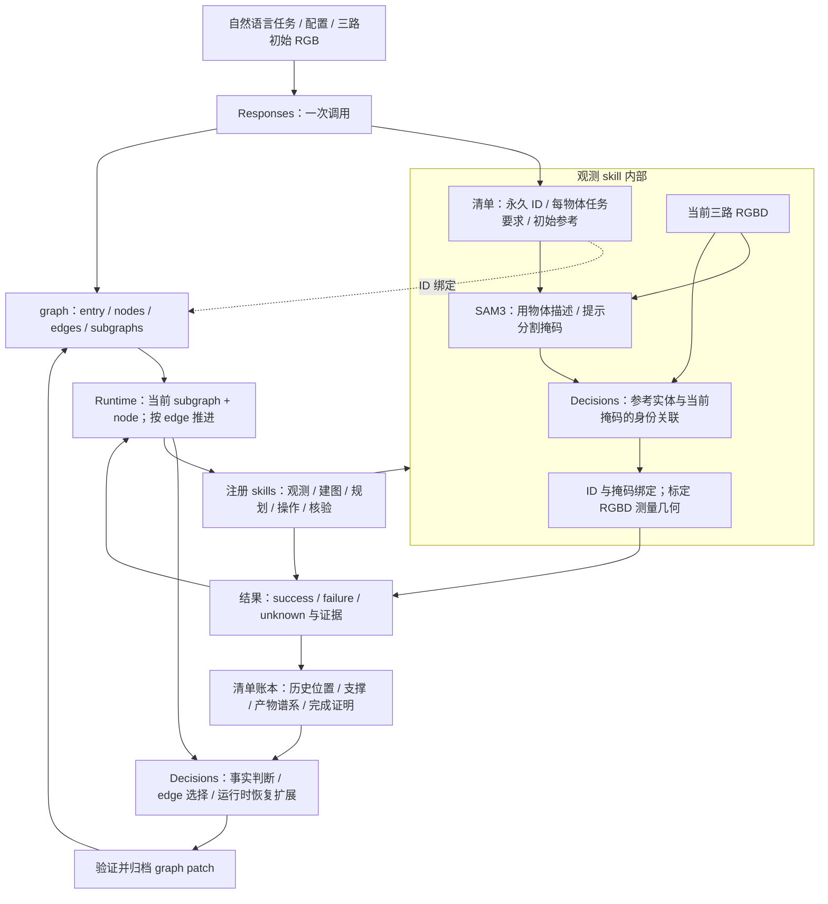
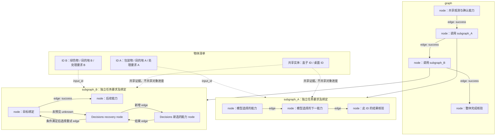

# 清单与可执行 graph

2026-10-29 更新：实现采用 core（graph 类型与拓扑）、agent（Responses / Decisions）、runtime（edge 执行与校验）、skill_catalog / robot_skills（契约与实现）、web（归档回放）的分层。每物体完成后回配置观测位姿并观测是用户新增明确要求，写入场景任务条件，由 Responses 生成显式 node / edge；当前最终位姿为配置 observation，最后交付回位已满足时不额外移动。Decisions 恢复排除当前证据下已拒绝的参数组合，保留数值安全检查。21 个技能契约统一 Description / Inputs / Outputs。回放只保留一个 graph 主视图，支持 SVG / PNG / JSON 导出和图片、视频文件预览。详见 [GaP 源码对照与统一整体图](gap-source-audit-20261029.md)。

本轮按用户 2026-10-29 要求直接实施，不增加 Responses 或 sub-agent。

真实双物体实验发现：剩余目标未知时，整次观测被拒绝，连已经确认的已放置物体几何也无法更新，导致建图和换位姿能力不出现在 Decisions 选项中。现将清单确认后的部分测量与完整身份覆盖分开：返回已确认子集、缺失 ID 和 complete=false，未知掩码不进入几何；地图账本保留未移动实体历史层，并继续拒绝已失效或从未建立的必需层。恢复动作仍由 Decisions 生成，不能以部分观测直接授权抓取或声称覆盖完整。

清单保存永久 ID、历史证据、每物体的任务要求与完成账本。graph 保存控制关系；每个目标 ID 拥有独立 subgraph，根 graph 调用它们并协调共享能力和最终核验。node 是一次能力调用、subgraph 调用、Decisions 判断或结束；edge 决定下一 node。数组排列不决定执行顺序。这是结合 GaP 核心思想的项目格式，不冒称与官方 v3 JSON 二进制兼容。

初始 Responses 一次同时返回候选清单、任务要求和显式 graph。逻辑上先确定候选物体和要求，再引用这些 ID 编写 subgraph；之后由运行器分配永久 ID，并由 SAM3/Decisions 确认当前身份。不可见不删除历史记录，历史位置不冒充当前几何。

遇到未预见且无现有 edge 处理的结果，Decisions 可以选择注册能力和有类型的参数，逐步生成恢复 node/edge。每次选择归档原始请求、结果、graph revision 和触发证据，保存后才执行。它不能改变目标、清单 ID、已完成动作或数值安全约束；物理执行存在未确认副作用时不能直接重试。没有证据进展的重复操作会被拒绝，不限制整个任务的 Decisions 次数。

实现顺序：显式数据模型与结构/能力验证；按 edge 执行及物体作用域；Decisions 恢复扩展；Responses 与运行入口接线；回放显示真实 graph、revision、执行路径；针对性与全量检查、真实服务实验。旧 steps 执行器及专属兼容测试已删除，历史归档只供阅读；生产仅有一次 Responses 和 version=2 graph 入口。

验收：改变 node 数组顺序不改变路线；更改 edge 改变路线；两个 ID 的绑定/产物/完成记录隔离；未知结果可在没有初始恢复 edge 时由 Decisions 产生恢复；拒绝非法 edge、不满足前提的参数、旧几何授权及动作重放；回放读取存档 topology 而非由动作日志拼装。

## 层级与控制关系

这里 graph 是执行控制者。SAM3/Decisions/地图并非脱离 graph 自行运行的一条旁路：图选择观测能力后，该能力才执行内部感知；图选择建图/抓姿/运动能力后才消费相应证据。清单不取代 graph，它保存“处理谁、要求是什么、哪些事实成立”；graph 保存“接下来做什么”。

## 多物体独立 subgraph

此示意不规定 A 必须先于 B，也不规定恢复必须选择观测。真实顺序、能力与参数来自模型输出，回放读取真实存档。物体被暂时遮挡时仍保留原始 ID、最后观测、已验证支撑与操作历史；若当前证据不足，由 Decisions 判断下一步可用能力。换视角移动仍需地图、空手、关节和碰撞检查。可用能力无法取得新视角时应报告具体缺口，不能假称已换视角。

GaP 参考：[workflow schema](https://graph-robots.github.io/graph-as-policy/reference/workflow-schema.html)、[executor semantics](https://graph-robots.github.io/graph-as-policy/reference/executor.html)。本项目采用显式 graph 控制、subgraph 作用域和结果路由思想；保留原有机器人契约、串行机器人调度和清单归属。未引入其多 agent 编程、在线学习或并发机器人调度，也不宣称完全复刻官方 runtime。

静态检查会明确报告可安全重试 node 的已知前提缺口，作为运行时 Decisions 需处理的诊断；不会假称初始 graph 已安排所有前提。实际派发仍在前提成立前拒绝技能。不可安全重试的物理能力前提冲突仍拒图。初始 graph 不因此获得任何运动安全豁免。

运行实验还暴露并修复两处边界问题：恢复上下文中的 NumPy 技能结果必须转换为模型可消费的 JSON 摘要；`task.processing` 必须仅允许 contract 中 `processing_effect=true` 的加工能力，不能混入普通动作序列。原始结果仍完整归档，普通搬运加工要求为 `[]`。
