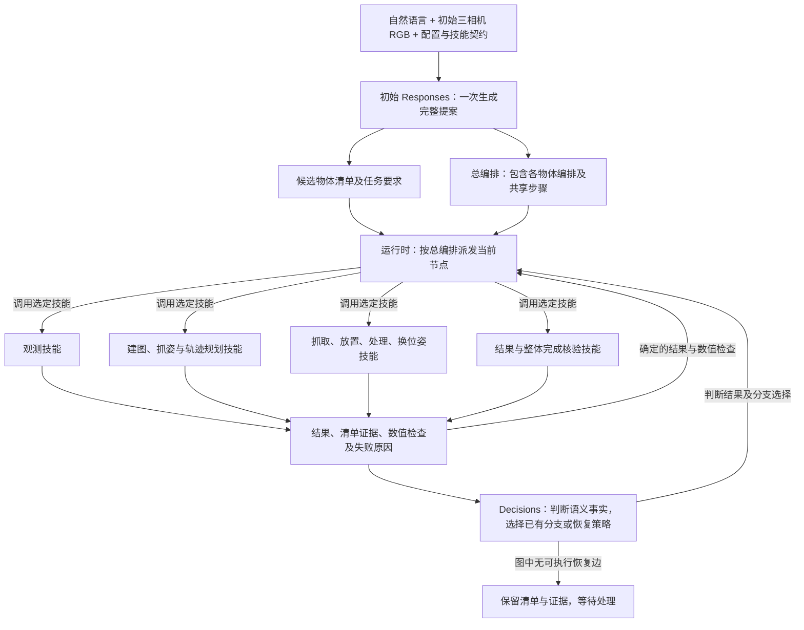
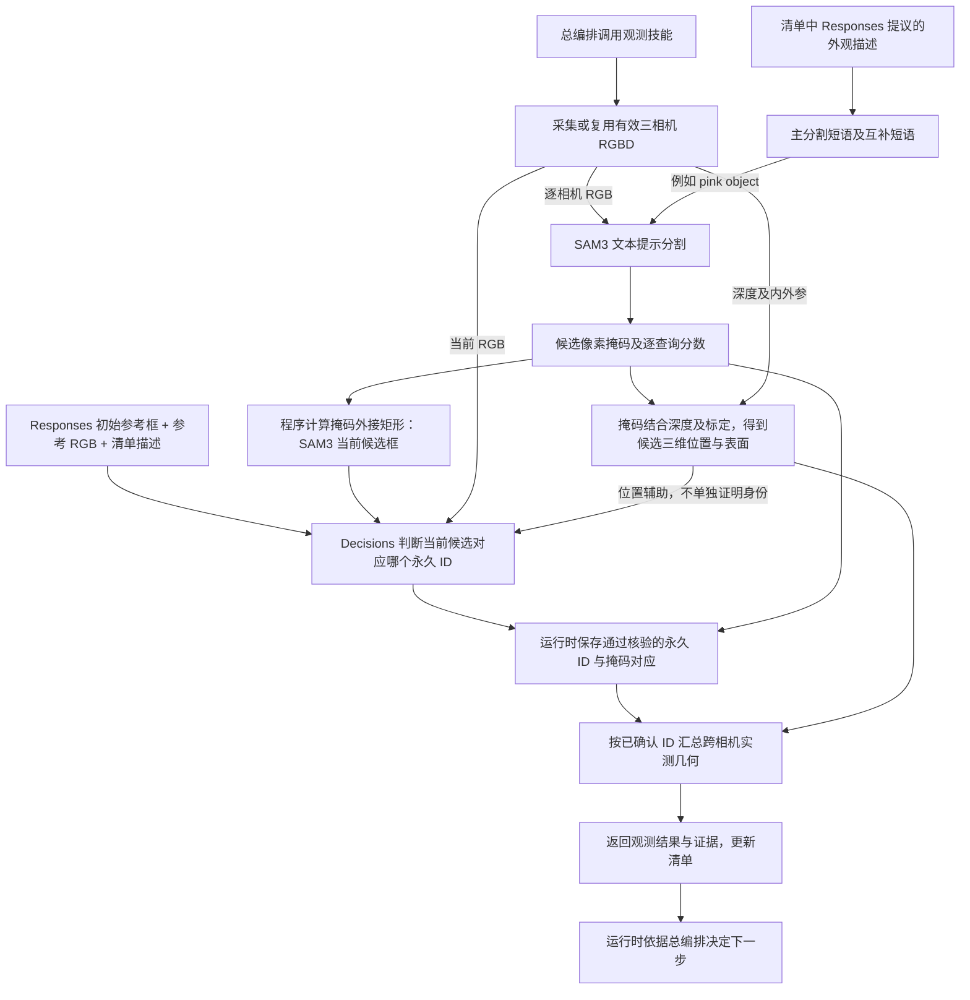

# 物体清单、任务要求与任务编排

2026-10-29 更新：统一使用 Graph（总编排图）、Subgraph（物体编排子图）、Node（节点）、Edge（边）；分层控制图和多物体图见 [Graph 与清单记忆](graph-policy-and-memory.md)。生产入口仅允许一次初始 Responses，不自动修正或再次编排。以下术语中“总编排”“物体编排”分别对应 Graph 与 Subgraph。

本轮实现的是：清单中每个待搬运输入物体有独立任务要求和独立物体编排，总编排协调它们。桌子、盒子等仅作支撑或障碍的实体仍在清单中，但不因此获得一个“搬运自己”的编排。

| 统一名称 | 回答的问题 | 代码对应 |
|---|---|---|
| 物体清单 | 有哪些实体、分别是谁、当前证据和进度是什么？ | inventory、永久 ID、进度账本 |
| 任务要求 | 从哪里送到哪里、经过什么处理、如何判定完成？ | TaskSpec |
| Graph：总编排图 | 整项任务何时调用哪个技能、如何分支和恢复、怎样整体验收？ | PolicyGraph |
| Subgraph：物体编排子图 | 总编排中负责某个输入物体及其产物的部分 | object_task.body |

“策略图”就是任务编排的图结构表示，不是另一个控制器；“子图”就是总编排中的物体编排。任务要求是验收目标，不是动作流程。

初始 Responses **一次请求、一次结构化回答**同时产生候选物体清单、任务要求和总编排。逻辑上编排引用同次回答中清单的物体引用名；运行时检查引用存在，再统一绑定为永久 ID。不是先调用一次生成清单、再调用第二次编排，也不能声称知道模型内部推理的先后次序。身份及任务成员关系仍需图内观测和清单确认能力核验。永久 ID 字符串由运行时分配；SAM3 不分配永久 ID。

## 控制关系

下图表示控制与反馈，不是一套固定执行顺序。初始原始图像是首次 Responses 的启动输入；之后所有任务步骤，包括观测、建图、规划、动作、换位姿观测和核验，都由总编排选择。

不是每个技能结束都需要额外调用 Decisions。接口结果、版本、关节限位、IK 和碰撞等确定性检查由代码完成；需要判断身份、关系、放置结果或恢复选择时调用 Decisions。模型肯定不能覆盖数值检查失败。

## 观测技能内部的数据流

当前 SAM3 输入是某一路 RGB 和一个英文外观短语，不输入永久 ID，也不把 Responses 初始参考框当作 SAM3 必须遵循的分割边界。每个短语可返回零个、一个或多个掩码。相同短语去重；普通对象无候选时允许有限的颜色 object/shape 备用查询，结果仍需核验。

Decisions 比较当前候选 RGB 主体与初始或产物参考，输出身份或拒绝/未知；它不画像素掩码。候选阶段已经可用标定深度计算表面位置，并作为辅助信息提供给 Decisions，因此当前实现不能称为“完全不需要深度和标定的关联”。程序只将已接受对应绑定到永久 ID，再按 ID 汇总多相机几何。严格的静止容器像素和深度对应也可以沿用已验证身份；颜色或历史位置不能单独赋予身份。

观测返回几何不代表已经建图或生成抓姿。总编排选择建图技能后才更新 TSDF/ESDF，选择抓姿技能后才将选中 ID 的点云交给 GraspGen，选择轨迹规划技能后才调用 cuRobo。

| 框的完整名称 | 来源 | 去向 |
|---|---|---|
| Responses 初始参考框 | Responses 提议相机和框坐标，程序绘图 | 发给 Decisions，指出历史参考实体；不是掩码 |
| SAM3 当前候选框 | 程序计算当前掩码的二维外接矩形 | 发给 Decisions，指出待关联候选；编号不是永久 ID |
| 物体身份结果框 | 已接受的永久 ID 与当前掩码对应，程序绘图 | 供人看回放；程序消费底层对应与几何，不再使用该叠加图片 |

新模型输入图使用完整英文 Reference / Candidate 标签及编号。历史请求保留原始图片，不改写已发送证据。

## 一个具体例子

同一任务要求物体 A 直接放进右盒，物体 B 拆包后把产物放进右盒。它们可以共享目的地，却不能共享处理要求。

| 内容 | 物体 A | 物体 B |
|---|---|---|
| 永久输入 ID | A | B |
| 任务要求 来源 | 原始支撑/容器 ID | 原始支撑/容器 ID |
| 最终目的地 | 右盒 ID | 右盒 ID |
| processing | 空列表 | vla_unpack |
| 完成要求 | A 经核验位于右盒 | B 的独立产物经核验位于右盒，且有拆包记录 |
| 物体编排 | Responses 独立选择直接运输及核验策略 | Responses 独立考虑 VLA 前提、输入区、产物身份与后续运输 |

这里的路线只是解释示例，代码不生成这两套流程。模型输出的 object_task 节点包含 task 和 body；body 就是物体编排。它与总图使用相同的技能、条件和恢复语法。物体编排不是另一次 Responses 调用，也不是每个物体新开一个 agent。

Responses 提出候选清单，并为候选待搬运物体编写独立任务要求和物体编排；实际观测确认后冻结选中数量。未选中的候选仍可作为障碍；已完成项跳过。整体任务要求保存用户原始任务、整体选择范围和最终机器人姿态。每件物体的目标不会因另一件物体成功而被标记完成。处理产物获得新 ID，通过 root_input_id/工序关联沿用其输入任务的义务。

清单是编排的身份基础，但不独自决定动作顺序。总编排负责协调共享机器人和地图；物体编排负责对应物体的动作路径；任务要求是验收合同。当前按物体编排顺序执行，并非两个物体编排并发控制双臂。数值最近排序与显式物体编排顺序可能冲突，初始提示要求模型使用 explicit 或 inventory 安排独立物体编排。

## 关键词、框和 ID

Responses 输出 appearance_keywords（可见颜色、形状、纹理、特征）和 segmentation_aliases（最多两个短英文同义描述）。SAM3 分别使用主描述和别名查询，保留逐相机、逐查询分数及掩码；同一候选的重复检测仍需去重。这些词都是提案，不能变成身份证明。

SAM3 不分配永久 ID。它只说明某张图上哪些像素可能属于所描述对象。Decisions 将当前候选与清单描述、历史参考、当前多相机图进行对应，输出身份判断；runtime 保存 ID 与已确认掩码的关系。掩码随后与标定深度一起用于抓姿和地图。多个候选可以对应同一个物体 ID，但不确定候选不进入该物体几何。

因此，关键词提高的是描述覆盖和可区分性，不保证概率上涨。错误形容词可能反而误导。SAM3 分数和 Decisions 概率仍分别归档，任何置信门槛和碰撞检查都没有降低。

## Decisions 优先恢复

recover 节点包含一个 attempt 能力、多个由 Responses 编写并解释用途的 strategies、最多六次能力尝试。只有契约声明 recovery_retry_safe 的能力可放在 attempt；抓取执行、放置执行、VLA 效果等不能自动重放。

失败后 Decisions 收到原能力、详细错误、可选策略、能力前提与效果、当前事实、清单账本和尝试历史，选择策略或 exhausted/stop/unknown。runtime 只执行选中的已有分支，再尝试原能力。恢复分支自身的技能失败也回到这次选择，不提前转交 Responses。相同观测、地图版本、账本、错误和事实下重复同一策略会报告无进展。失败并不抹去原始判断证据。策略中的运动仍要满足真实前提和数值安全检查。

当前生产入口的额外 Responses 预算为零，初始 schema 不提供 replan 节点。恢复耗尽后保留证据并等待处理，不自动再编排。服务不可用、无合法观测动作或部分物理执行没有恢复能力时仍可能停止；不能把无限重问描述成一定能完成。

多物体图生成可能超过原来与 Decisions 共用的请求超时。Responses 使用独立的 LUNA_RESPONSES_TIMEOUT_S，默认 180 秒，避免较长的首次编排被短判断请求的上限截断；没有增加自动 Responses 重试。传输错误记录具体异常类型及配置超时，不能把 ReadTimeout、连接失败和视觉置信不足混为一谈。

首次编排输出预算为 24000 token（包含推理），因为实际双物体图曾耗尽 12000 token 而没有完整输出。所有物体编排及恢复分支合计上限 512 节点，仍保留五层嵌套上限和执行步数预算。它们是防止截断与无限执行的资源限制，不规定动作路线。清单确认在冻结后重复调用只返回原始选择，不重新选物、不覆写初始证据，也不声称当前场景已重新核验。

Decisions 调用不设每任务总次数上限；单个 recover 有界，失败策略可以再交 Decisions 选择其他策略。它不会通过重复询问同一份证据，直到随机得到高分，来证明身份或成功。策略应补充或改变证据、参数、合法视角或规划候选；没有可执行恢复边时不追加 Responses。

## 可见性与验收边界

回放直接展开每个物体的任务要求、物体编排和恢复策略，并保留实际 Decisions 恢复选择事件。图展示模型的原始编排，即使节点尚未执行；身份叠加图是给人的解释层，模型实际使用的原始 RGB、Responses 初始参考框图与 SAM3 当前候选框图和回答另有归档。

这次结构允许不同物体拥有不同目的地和处理要求。是否胜任具体新任务，还取决于可用能力、可观测性、抓姿、可达性和数值规划，不能据此声称任意 grasp-place 都已验证。实际测试结果另行记录，单测和冻结感知对照不等同于完整物理成功。

补充观测按用户定义必须改变机器人观测位姿；原位再拍单独称为重新采集。当前可用的是配置好的双臂观测位姿能力，不是自由生成任意相机轨迹。Responses 编写合法运动与地图前提，Decisions 根据遮挡或出画情况选择；程序不在失败后暗中插入移动。

最新实测结果、失败原因和冻结输入对照见 [验证记录](object-task-validation-20261029.md)。独立编排已经实现，双物体整任务稳定性仍未验收通过。
