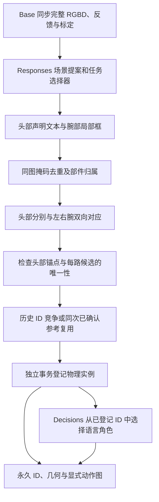

# 完整视野、实例分组与永久 ID

Responses 每个任务只调用一次，接收三相机完整 RGB 和用户指令，要求先填写场景段，并分别输出 `declared_objects`、`scene_inventory`、`task_selectors`、`destination_regions` 和显式 graph。场景提案和框没有永久身份；任务条件保留用户原文，不把模型猜到的形状或颜色追加为用户要求。

## 完整物体先于可达性

采集不再投影工作空间像素掩码，不对 RGB 或深度清零。SAM3 的完整轮廓保留，测量仅排除无效深度和机器人自身返回点。桌子或盒子跨过机器人可达边界也保持一个完整实体。离线工作空间仍用于可达性查询，后续 IK 和完整碰撞检查仍有效。

历史参考显示原先保存的完整 RGBD 和已确认实例掩码，不重新投影工作空间。旧掩码已被裁切的部分不会凭空补全；旧 RGB-only 参考也不伪造深度。历史原始档案保持原样。

## 同图去重及部件归属

例如“场景：一张桌子、一个黑色 CAD 物体、两个蓝色盒子。任务：把桌面上的黑色 CAD 物体放到右侧盒子。”三个声明短语限定 SAM3 查询。若相机中出现粉色包裹，其深度仍进入碰撞测量。两只蓝盒分别建立身份，Decisions 再结合机器人坐标选右侧盒。每个选择器及每个 Responses 提案必须引用场景原文。

头相机对每个声明类别检索一次。Responses 只为确实可辨认的表面给框。腕部只在本相机可见框、经本相机当前 RGBD 复核的已有框、或同次头部候选的深度投影框内调用 SAM3。投影需要至少 30 个当前深度像素，并覆盖至少 55% 的可比较像素。原始深度保留作碰撞输入。

桌面使用头相机测出的水平面及面内 RGB。只有一张声明桌面时，腕部主要落在明显更低的平面且几乎没有像素达到桌面高度的候选会被剔除。头部与每只腕部独立确认桌面。

盒子轮廓和内容物掩码可能覆盖同一可见像素。对同一时刻已分组的物体，将重叠像素的标定深度投到另一相机，要求深度吻合且该视角只有内容物拥有这些像素。仅从盒子可见表面剔除有独立证据的部分，保留原始 SAM3 掩码和深度。

`instance_masks.py` 使用同图对称 mask IoU >= 0.70 整理近似重复假设。每个重复集合内任意两张掩码都须满足条件，防止 A 近似 B、B 近似 C 导致 A/C 被间接合并。优先保留像素覆盖完整的轮廓；分数只参与后续排序。这个阈值是分割假设整理规则，不是 Decisions 置信度，也不能用矩形框 IoU 或单向包含率代替。

其余同图掩码先独立检查物理类别：完整场景和单主体细节用于拒绝机器人、房间地面/背景及混合实体掩码；已确认类别供后续复用，不重复提问。然后在相同物理类别内由单题 Decisions 选择“该表面所属物理实体的最完整代表掩码”。全部问题看到同一候选集、完整图和精确 RGB/二值掩码细节。桌面、桌边属于同一桌子，盒壁与盒底属于同一盒子；盒中物体独立。同一实体的正向归属可以传递，包括互相指认。收齐全部归属后求组件，再确定覆盖充分的代表；类别冲突、指向无效掩码或未解歧义不能注册。相机之间的一对多或不一致循环仍属于冲突。

确认是同一实体的互补表面取并集，重算有效点云、掩码哈希和采集内候选 ID，保留所有检索及来源候选。不同实体的相互包含关系不触发自动合并。

## 跨相机统一对应

程序分别计算头部与每只腕相机的双向投影。跨相机深度允许相差 25 mm，常规投影 IoU 门槛为 0.50，表面纯度和可见深度一致率为 0.55，至少需要 30 个共同深度像素。稀疏表面可用双向一致度 0.65 配合独立三维证据。数值用于候选对应，要求双向唯一。腕部单独观测和竞争冲突保持待定。已知 CAD 可提供辅助位姿。容差是当前应用初值，设备噪声仍待真机标定。

## 跨时刻与提交

`temporal_identity.py` 对独立新采集使用当前全部竞争组、首次/最近及较早历史参考和实际操作历史，选择已有 ID、new_instance、reject 或 unknown。旧位置不同、低 IoU、暂时未见不能证明新物体。多个当前组争用同一 ID 时先联合核验。赢家确定后，剩余组可让 Decisions 再比较尚未分配的历史 ID。复核只接受唯一旧 ID，仍有冲突则保持 unknown。

只有在同一采集号、代次、RGBD、有效深度、标定及每个成员掩码完全一致时才直接复用唯一 ID。有历史记录的新采集即使机器人关节完全静止，也由 Decisions 核对当前物体与历史身份，静止反馈和几何重合一并作为证据传入。空库中的第一批已确认独立物体直接登记。

`ObjectRegistrar` 在单个事务中验证采集、代次、测量、候选唯一性、相机唯一性、旧 ID 唯一性和数据库 revision。无冲突物理事实独立提交；任务 unknown 不回滚它们。首次参考不可覆盖，同次组重复提交幂等，未见对象保留原 ID。新记录使用 `registration_basis=scene_association_v3`。

## FoundationPose 与后续任务

FoundationPose 的职责是已知 CAD 的 6D 位姿估计。它可辅助歧义关联，不能单独分配身份，未知 CAD 也能建立 ID。已知 CAD 的后续碰撞几何与离线抓姿仍需要当前有效位姿；同采集、同掩码、同模型哈希的候选位姿可以复用，身份或掩码改变后不能套用。

身份先提交到实验数据库。`task_grounding.py` 为每个待绑定的目标、来源、支撑或目的实体发出同一种 Decisions 选择题。问题包含用户原文、Responses 提取的角色与限定语、相关引用、当前带 ID 的图像、机器人基座坐标以及同次初始候选框。选项限于当次已登记、物理类别相容的 ID。序数由 Decisions 比较整个集合，多个目标逐个列出并确认枚举结束。证据不足返回 unknown。单一目标一经绑定，后续沿用同一物理 ID。指定桌面 XY 通过已绑定的桌子和配置区域确定。执行前的真实支撑证据、IK 和碰撞检查仍由各自技能负责。

## 验证边界

上一版本 v22 完整任务验收为 0/10，保存在 `data/acceptance/scene-association-redesign/`，不改写。本轮完整视野、重复分割、对应冲突和历史复用的证据位于 `data/acceptance/full-frame-association/`。静态回归、冻结真实模型回放与完整任务分别报告，不以分组或绑定成功代替任务成功。

实例登记、物体位置与颜色、桌面拟合、CAD 配准和后续主参考图固定使用头部相机。两个腕相机分别补充经过头部配对的表面和局部证据。任务进度保存目标、目的地、核验结果和重试次数。
