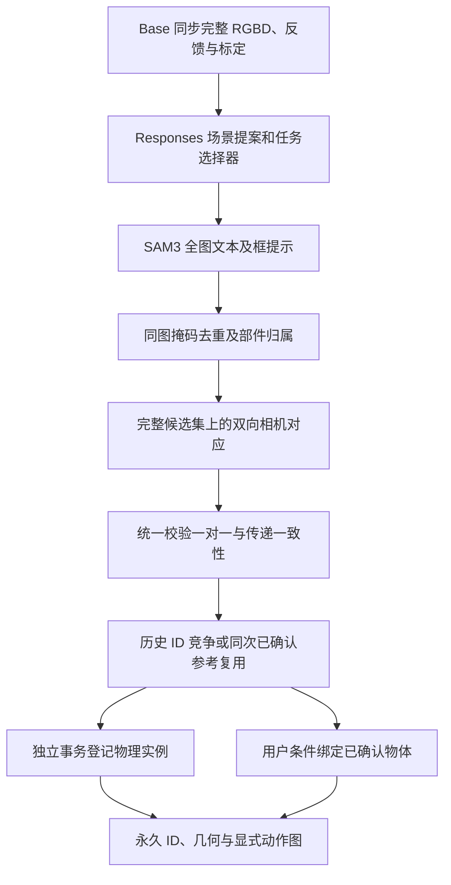

# 完整视野、实例分组与永久 ID

Responses 每个任务只调用一次，接收三相机完整 RGB 和用户指令，要求先填写场景段，并分别输出 `declared_objects`、`scene_inventory`、`task_selectors`、`destination_regions` 和显式 graph。场景提案和框没有永久身份；任务条件保留用户原文，不把模型猜到的形状或颜色追加为用户要求。

## 完整物体先于可达性

采集不再投影工作空间像素掩码，不对 RGB 或深度清零。SAM3 的完整轮廓保留，测量仅排除无效深度和机器人自身返回点。桌子或盒子跨过机器人可达边界也保持一个完整实体。离线工作空间仍用于可达性查询，后续 IK 和完整碰撞检查仍有效。

历史参考显示原先保存的完整 RGBD 和已确认实例掩码，不重新投影工作空间。旧掩码已被裁切的部分不会凭空补全；旧 RGB-only 参考也不伪造深度。历史原始档案保持原样。

## 同图去重及部件归属

例如“场景：一张桌子、一个黑色 CAD 物体、两个蓝色盒子。任务：把桌面上的黑色 CAD 物体放到右侧盒子。”三个声明短语限定 SAM3 查询。若相机中出现粉色包裹，其深度仍进入碰撞测量。两只蓝盒分别建立身份，再按机器人坐标选右侧盒。每个选择器及每个 Responses 提案必须引用场景原文。

当前相机的 Responses 框仅在文本结果尚未覆盖该实例时补充视觉提示。以框提示返回的候选须同时满足框内掩码覆盖和外接框 IoU 各至少 0.5；整个掩码保留。新采集重新检索声明文本。上一观测确认的同类掩码可以用标定投影到当前相机，至少 30 个像素有当前深度支持且深度一致率达到 0.5 时，用投影区域补充分割提示。独立的跨时刻身份仍由 Decisions 核验。精确相同掩码合并来源，归属核验剔除误分的背景和未声明实体。

`instance_masks.py` 使用同图对称 mask IoU >= 0.75 整理近似重复假设。每个重复集合内任意两张掩码都须满足条件，防止 A 近似 B、B 近似 C 导致 A/C 被间接合并。优先保留像素覆盖完整的轮廓；分数只参与后续排序。这个阈值是分割假设整理规则，不是 Decisions 置信度，也不能用矩形框 IoU 或单向包含率代替。

其余同图掩码先独立检查物理类别：完整场景和单主体细节用于拒绝机器人、房间地面/背景及混合实体掩码；已确认类别供后续复用，不重复提问。然后在相同物理类别内由单题 Decisions 选择“该表面所属物理实体的最完整代表掩码”。全部问题看到同一候选集、完整图和精确 RGB/二值掩码细节。桌面、桌边属于同一桌子，盒壁与盒底属于同一盒子；盒中物体独立。同一实体的正向归属可以传递，包括互相指认。收齐全部归属后求组件，再确定覆盖充分的代表；类别冲突、指向无效掩码或未解歧义不能注册。相机之间的一对多或不一致循环仍属于冲突。

确认是同一实体的互补表面取并集，重算有效点云、掩码哈希和采集内候选 ID，保留所有检索及来源候选。不同实体的相互包含关系不触发自动合并。

## 跨相机统一对应

`current_instances.py` 不按顺序占用候选。每个主体对另一相机的选择始终面对该相机完整的可行候选集。提供完整三相机场景及有关主体细节，位置采用 Link_Base：+X 前、+Y 左、+Z 上。

程序可接受唯一且双向充分的当前深度对应：两个方向均至少 30 个共同深度像素、投影掩码 IoU >= 0.5、投影落入目标掩码的比例 >= 0.75、投影深度一致比例 >= 0.7、覆盖目标有效表面的比例 >= 0.5，并且两端各自在对方相机只有一个满足条件的候选。腕部与头部采样密度不同时，两侧仍须通过共同像素、投影精度和深度一致检查；允许一侧达到投影 IoU/覆盖门槛，且实测三维包围盒 IoU 至少 0.5。另一个可验证的对应是两组点云在 1 厘米体素中交集至少覆盖较小可见表面的 65%，仍须通过双向投影精度、深度一致性及唯一性检查。若初始声明只有一张桌子却出现多个组，程序用已声明的桌上物体作为几何证据。检查物体投影附近实测表面的高度、水平内点比例与接触间隙。仅当一组支持该物体且其余组全部显著低于它才排除误分；其余数量冲突保留 unknown。深度容差仍为 15 mm 的应用初始 allowance，不是传感器认证精度。所有门槛和原始数值归档。不可见或无共同支持返回 unavailable，不能当成零匹配或不同物体的证明。

其余可行对应调用 Decisions，可选候选、none 或 unknown。候选 CAD 位姿只在此时按需补充；没有 CAD 或配准失败均不构成身份失败。相同 CAD 不能证明两个候选是同一个实例。

全部回答产生后统一求连通组件。每对已关联相机必须双向同意，三相机的传递关系必须一致，每组每相机最多一个实体。多对一、反向矛盾或第三相机冲突使相关组件 unknown，不进行重复投票，也不按最高分强行注册。

## 跨时刻与提交

`temporal_identity.py` 对独立新采集使用当前全部竞争组、首次/最近及较早历史参考和实际操作历史，选择已有 ID、new_instance、reject 或 unknown。旧位置不同、低 IoU、暂时未见不能证明新物体。多个当前组争用同一 ID 时联合核验，未获选组保持 unknown。

同一冻结采集中的已确认参考，仅在代次、RGBD、有效深度、标定和每个成员掩码完全一致且 ID 唯一时由程序复用，不发 Decisions 请求、不伪造 request_hash。连续抓取执行继承身份的现有合同保持不变；普通的跨时刻位置接近不适用这个例外。

`ObjectRegistrar` 在单个事务中验证采集、代次、测量、候选唯一性、相机唯一性、旧 ID 唯一性和数据库 revision。无冲突物理事实独立提交；任务 unknown 不回滚它们。首次参考不可覆盖，同次组重复提交幂等，未见对象保留原 ID。新记录使用 `registration_basis=scene_association_v3`。

## FoundationPose 与后续任务

FoundationPose 的职责是已知 CAD 的 6D 位姿估计。它可辅助歧义关联，不能单独分配身份，未知 CAD 也能建立 ID。已知 CAD 的后续碰撞几何与离线抓姿仍需要当前有效位姿；同采集、同掩码、同模型哈希的候选位姿可以复用，身份或掩码改变后不能套用。

身份确认后，`task_grounding.py` 检查声明类别、颜色、机器人左右和支撑/包含关系。桌面支撑先用局部水平平面、物体底部与平面高差、物体足迹覆盖率判断，数值不足才提视觉关系题。放置容器先绑定永久 ID，再从该容器当前三维几何定义释放区域。once 绑定移动后保持原 ID；each_selection 用于集合下一轮选取。确认目标不等于运动许可，地图、IK、碰撞、反馈与显式 graph 的前提独立检查。

## 验证边界

上一版本 v22 完整任务验收为 0/10，保存在 `data/acceptance/scene-association-redesign/`，不改写。本轮完整视野、重复分割、对应冲突和历史复用的证据位于 `data/acceptance/full-frame-association/`。静态回归、冻结真实模型回放与完整任务分别报告，不以分组或绑定成功代替任务成功。
