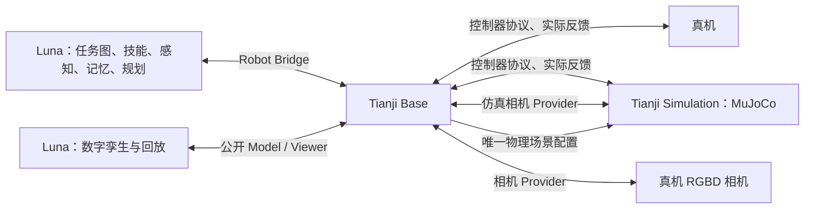

# Luna 经 Tianji Base 统一接入真机与 MuJoCo

日期：2026-11-16。状态：用户已批准，按补充要求实施。

用户补充：计算用 FK 和机器人点云剔除采用 cuRoboV2-Fast v0.9.0 公开 API；录像归 Luna；所有任务观测必须等待三相机就绪、曝光/画面稳定并匹配同步 RGBD。Luna 保留三相机预览与冻结任务观测，嵌入 Base 的数字孪生，不维护第二个仿真器。Base 控制台承担设备、标定、物理场景和手动调试。

## 目标与范围

Luna 保留 Responses 编排、Decisions、技能、时间记忆数据库、感知生成的空间记忆、cuRobo 规划、工作台和实验回放。机器人控制、实际状态、相机数据与机器人展示资源统一经 `tianji_base` 获取。Base 按其配置的控制器 IP 接入真机或 `tianji-simulation`。Luna 不连接控制器 UDP、不导入仿真器、不直连仿真相机、不修改物理场景。

这里“只和 Base 通信”指机器人、传感器及仿真接入边界；现有 OpenAI 与 `tianji-algorithms` 调用保持其职责。算法不搬入 Base，官方 SDK 不修改。

本次用户明确要求涉及 Luna、Base、Simulation 三个仓库，覆盖 Luna AGENTS 中原来的目录限制；其余约束继续适用，不创建工作树，不使用 sub-agent，不改其他用户服务。`tianji-demo` 仅作为已有 Bridge 客户端与无物理引擎 URDF 实现的只读参考，不作为 Luna 的运行依赖。

## 设计时核对的现状（实施前）

| 仓库及提交 | 已确认事实 |
| --- | --- |
| Luna `b1df28d` | `app.py` 创建 `Simulation`；`simulation.py` 负责物理、运动、夹爪、相机、场景修改、拆包替换物体；`kinematics.py`、`robot_surface.py`、`experiment_video.py` 等也使用 MuJoCo |
| Base `3d378a8` | 已有 `/api/extensions/jodell.robot-bridge/v1`，提供状态、采集、准备、有限轨迹、夹爪、停止、租约与 VLA；提供 URDF Viewer 的公开嵌入描述 |
| Simulation `518c5a5` | 虚拟控制器复用真机 UDP 协议，场景通过 Base 的 workcell API 同步；MuJoCo 入口明确报告不提供 Isaac 相机服务 |

Base 的 `xinming-camera/simulation_driver.py` 当前消费 Isaac RGB，明确声明 `depth=false`。Bridge 的 `observation.py` 目前仅接受 `timestamp_source=sdk_capture`、`depth_to_color_software` 与毫米深度，并核对物理相机 SN。三路是逐台读取，不保证仿真三个视角来自同一个冻结状态。因此现有接口可作为入口，但不能声称当前已支持 MuJoCo RGBD。

2026-11-16 从本会话请求 `http://127.0.0.1:8000/api/core/v1/health` 被拒绝连接。该地址按用户说明作为仿真 Base 地址；源码中的示例端口不能推翻用户指定。尚未读取运行实例的 Profile、相机外参覆盖或控制器 IP。

本地 Luna 的三组 `T_parent_rgb_m` 与本地 Base 默认外参逐元素比较，在毫米转换为米后差异为零；这不证明运行实例没有自己的覆盖值。

## 方案取舍

推荐沿用 Base 现有 Robot Bridge、Camera Capability、Model 和 Viewer 契约，在这些边界补齐仿真支持。这是唯一同时满足当前三个硬要求的主方案：Luna 无 MuJoCo、机器人访问必经 Base、物理场景由 Base 管理。用户已明确这些边界，用户随后批准实施；当前落地与验收状态见 ../../base-integration.md。

保留 Luna 本地 MuJoCo 并切换运动后端，会继续留下第二个物理状态和渲染相机，不符合要求；Luna 直接访问 Simulation 的控制器或相机，同样不符合要求。完整复制 `tianji-demo` 会把另一套编排与历史行为带入 Luna，不采用。

## 机器人执行边界

Luna 组合入口注入单一 Base 机器人适配器，业务技能依赖最小机器人接口。公开方法覆盖实际状态、RGBD、单/双臂轨迹、夹爪、停止、执行作用域与加工任务；协议错误、实测状态和回执保留原始来源。

| Luna 行为 | Base 现有 API |
| --- | --- |
| 被动读取实际反馈 | `GET state` |
| 明确设备准备 | `POST preparations/start`，随后查询 preparation |
| 冻结任务观测 | `POST capture` |
| 有限运动作用域 | `motions/begin`、heartbeat、end |
| 单臂/双臂时间序列 | `POST trajectory`，查询 `executions/<id>` |
| 开合夹爪 | `POST gripper-command`，等待实际完成 |
| 取消/停止 | `POST stop`，检查 cleanup 与新鲜反馈 |
| VLA | `vla/start`、status、heartbeat、stop |

每个动作保留 `client_id/request_id/bridge_instance_id/stop_epoch/expected_session_id/expected_geometry_revision`。丢失 POST 响应后按 request 查询，不能自动重新发送运动。Base 负责控制器接入、设备使能、独占、缓冲上传和确认停止；Luna 负责任务级动作绑定与 graph 结果。4 秒租约由独立轻量心跳维护，算法调用不得阻断心跳。

沿用 `planned` 轨迹入口，不使用会跳过碰撞检查的 `recorded_replay` 来接普通规划。Luna 的完整场景、目标接触规则和 attachment 检查仍执行；Base 原有自碰撞/限位/速度检查仍执行。若两层模型或接触策略不一致，报告冲突并修正公开配置，不能靠关闭一层检查通过。

应用内部使用 rad，Bridge 边界一次转换为 deg。规划侧时间伸长只执行一次，按 Base 原有 20 ms 缓冲协议传输；Simulation 既有控制器插值继续保留。命令已接收、控制器执行中、实测到位和清理完成分别记录。抓取中夹爪受物体阻挡可以是有效闭合，松爪仍需实际开到位。

Luna 的启动与读取页面不隐式连接或移动机器人。仿真和真机通过配置选择，不按 IP 字符串猜测能力。切换 Base 地址、控制器会话或模型版本时清除可执行计划和当前观测有效性；历史实验仍可读取。

## 三相机与标定

三机位保持现有角色：`1=right_wrist`、`2=left_wrist`、`3=head`。首次迁移采用 Luna 当前已记录的内参及对应外参作为仿真初始标定，迁移到 Base 管理的仿真标定资源；运行时不从 Luna 路径读取。

| 角色 | 父坐标 | RGB 分辨率 | fx / fy | cx / cy |
| --- | --- | --- | --- | --- |
| right_wrist | `TCP_Link_R` | 640×480 | 394.290741 / 393.803253 | 318.051361 / 229.735123 |
| left_wrist | `TCP_Link_L` | 640×480 | 393.447693 / 392.820007 | 320.053619 / 237.307312 |
| head | 固定 world/base_link | 640×480 | 370.130493 / 370.151794 | 321.005676 / 241.044647 |

表格仅用于核对；实际保存完整精度矩阵、内参和来源哈希。腕部 `T_flange_cam` 的父级为公开 FK 对应的安装端，不是再沿 Z 偏移 185 mm 的夹持前端。世界坐标变换只应用一次。

仿真相机使用独立虚拟传感器身份，明确记录原物理标定来源，不冒用真实 SN。Base 真机 Profile 继续按真实 SN 校验；仿真 Profile 明确选择与该仿真标定匹配的 Camera/Calibration Provider。Base 发布当前标定修订，Simulation 安装并回报已应用修订；修订未一致时不可生成有效任务观测。标定更新或场景重新编译须重建渲染资源并丢弃旧帧。

Simulation 新增 MuJoCo RGBD 服务，由模型编译时安装头部和双腕相机。RGB、深度、相机姿态、关节和夹爪来自同一个冻结物理状态；只在短锁内复制，专用渲染线程使用独立数据，不能让 GL 或 HTTP 阻塞 1 kHz 物理循环。队列采用最新帧覆盖，不积累延迟。

通过 MuJoCo 3.10 公共相机内参 API 设置 fx/fy 和主点，沿用经验证的光学坐标到渲染坐标转换，并用投影实验检查像素中心约定。官方依据：[相机内参定义](https://mujoco.readthedocs.io/en/3.10.0/XMLreference.html#body-camera)。不修改 MuJoCo SDK。

输出为理想针孔 RGB 与同分辨率、同光学轴的深度 Z；仿真记录 `rectified=true/lens_model=none`，不伪称复现真机镜头畸变。真实相机仍按其标定进行已支持的 RGBD 校正。无效或超量程深度置为无效，不填补未见表面。若 Bridge 沿用 uint16 毫米 PNG，明确保留单位转换与量化误差；不可使用深度预览灰度图替代测量深度。

## Base 相机适配与同步合同

在 Base 的 `extensions/cameras` 添加仿真 Provider，采用既有 `jodell.camera.stream/v1` 操作、状态和预览方式；同时提供匹配的仿真标定能力。Profile 显式选择它，真机和 Isaac 原有 Provider 保留。初始化与被动读取不擅自启动渲染服务，设备准备流程负责显式开启。

Luna 仍只调用现有 `robot-bridge/capture`。内部补齐原子帧组获取能力：一次锁定 RGBD 帧组，随后各视角都从该组读取，而非三次读取不断变化的 latest。对真机只能声明实测的同步偏差，不能声称硬件同时曝光；超出采集质量要求则返回不完整。

Bridge 需要有界、可验证的仿真来源支持，而不是放宽所有输入：

- 接受已选择的仿真 Provider 发布的 `simulation_capture`，验证模拟实例、控制器会话、标定和帧组身份；保留真机 `sdk_capture` 路径的要求。
- 接受明确的模拟 RGB 对齐深度标记，不把它写成软件配准的真机深度。
- 每组包含 frame-set ID、simulation instance、scene revision、calibration revision、采集时间与时钟域；每视角绑定 RGB、深度、K、外参和当时反馈。
- 仿真原始物理时间用于回放；不能直接与 Base 的 `monotonic` 相减。跨主机时必须建立时间映射并报告不确定度；首版部署优先 Base 与 Simulation 同一宿主时钟域。
- 对仿真腕部使用冻结时的已测关节计算外参；同时把冻结状态与控制器反馈作一致性检查。不能拿渲染结束时的 latest joints 生成过去图片的位姿。
- 机器人会话、仿真实例、场景或标定跨代变化时拒绝整组。任务有效观测不得降级为 RGB-only；预览可以显示诊断 RGB，但状态明确为不完整。

仿真场景修订不能仅复用当前 `geometry_revision`：该字段现在主要绑定机器人模型与外参。需经 Base 明确提供场景/仿真实例修订，并与 Luna 计划、观测和动作绑定；场景切换后停止旧任务后续下发。物体正常被操作的连续运动与人工重置场景需区别处理。

## 数字孪生、FK、回放与场景编辑

数字孪生复用 `jodell.viewer.embed/v1` 的 renderer 描述和公开模型资源。镜像姿态由 Base 的新鲜反馈驱动，不依赖另一个 Base 浏览器标签页是否正在运行 mirror 插件。若当前 scene 快照仅反映展示缓存，Base 应通过公开 Model `evaluate_scene` 生成隔离的实测视图，不向共享编辑状态写关节。

Luna 保留自己的点云、碰撞球、CAD/TSDF 和规划轨迹诊断图层，它们标明来源、观测和版本；不写回 Base 的物理场景。渲染器所需的诊断层通过公开嵌入契约扩展，避免复制 Base 前端私有模块。浏览器只访问配置 Base 的公开资源；若用 Luna 同源代理，限定资源和方法，不做任意 URL/控制请求代理。

删除 Luna 的物体增删、拖动、尺寸/颜色、物理桌面配置、场景 Apply/settle/confirm、仿真 Reset 以及对应后端写入口。物理场景编辑仅在 Base。Luna 的“重置任务”只停止所属动作并清除本次任务状态，不回退真实或仿真的世界。

Base 当前场景扩展新增的长方体和 CAD 默认是静态物体，不能假定与 Luna 的可抓取动态物体等价。迁移完整实验场景时，动态物体、碰撞形状、质量及模拟加工产物由 Base 所拥有的场景契约声明，Simulation 据此创建刚体；需要的通用场景能力补在这条既有链路上。不能为了让旧实验看起来可运行而在 Luna 偷建第二份场景。

保留任务的释放区域、VLA 工作区域、观察姿态与规划参数配置。这些是任务/规划输入，不是摆放或修改仿真物体。感知生成的碰撞场景、实例数据库和日志继续属于 Luna，不能以 Base 编辑器物体真值替代感知、SAM3、FoundationPose 或 Decisions。

从 Luna 移除 MuJoCo 依赖必须覆盖：本地物理线程、模型编译、相机渲染、FK、机器人深度过滤、夹爪/碰撞显示、演示校准脚本、场景视频渲染和部署环境。计算用 FK 和机器人点云剔除使用 cuRoboV2-Fast 公开 Kinematics / RobotSegmenter，由现有算法服务提供；显示与回放复用 Base 模型和 renderer。参照 `tianji-demo` 的既有 Bridge 客户端与固定样本验算，不跨项目导入业务代码。

新实验记录 Base 的实测关节/夹爪、RGBD 与标定、公开显示模型快照及版本。三维回放和导出走无 MuJoCo 渲染；相机视频直接来自归档图像。保留旧实验与已生成视频，旧几何包可由数据格式读取器转为显示网格，不保留旧物理执行入口。能力不足应明确提示，不能伪造旧视频重新生成成功。

## 拆包 / VLA 的迁移

原 Luna 直接替换仿真物体的模拟加工已删除。当前统一调用 Base 既有 VLA 生命周期接口；没有 Provider 时明确报告不可用。本次没有新增 Simulation 模拟加工服务，也不伪造其完成证据。实际 VLA 后仍由 graph 显式观测、核验产物与建图。

## 实施顺序与验收

1. 冻结 Base 相机帧组、仿真标定与状态修订合同；核对运行实例的 capabilities、Profile、模型和标定。保持已有真机接口可用。
2. 在 Simulation 安装三相机并发布冻结 RGBD；验证场景重编译、停止、重启、相机姿态和时钟。
3. Base 接入仿真 Provider，通过原 capture API 完整取得三相机与反馈；再做预览和设备准备。
4. Luna 接入 Bridge 状态/执行/采集，保留 graph、算法和证据语义，移除所有直接控制路径。
5. 完成 Viewer、纯 URDF 几何、回放和拆包迁移；删除物理场景编辑及 MuJoCo 依赖，同步合同、README、部署配置和开发约束。
6. 跑完整仿真抓放与失败恢复；实机先被动验证接口，实机运动另按现场已明确的授权执行。

验收不能只看页面或 health：

| 验收项 | 必须有的证据 |
| --- | --- |
| Luna 无 MuJoCo | 在未安装 MuJoCo 的环境完成应用启动、观测处理、FK/过滤、显示和新实验回放；源码/依赖/部署扫描不再有可执行依赖 |
| 唯一控制通路 | 抓放、夹爪、回位、取消、VLA 的网络与回执均经 Base；停止 Base 后动作失败，不存在本地或直连回退 |
| 三相机 | 三路 RGBD 同组、K 和分辨率正确；已知平面深度、像素反投影、腕部运动后外参验证通过 |
| 跨代隔离 | 相机重启、场景编辑、Base 重启、换控制器和外参变化后，旧图/旧轨迹不能执行或入库 |
| 命令不重复 | 超时、丢响应、客户端退出、心跳中断均不导致重新执行，查询及停止回执可审计 |
| 实测语义 | 夹爪堵转、全开/全闭、实际到位和未知反馈符合现有 verify_grasp/place 合同 |
| 场景归属 | Luna 无物理场景修改入口；Base 修改后 Simulation 与展示一致，Luna 当前观测和计划按规则失效 |
| 任务行为 | 完整抓放、显式失败恢复、终止回位、模拟拆包和再观测均留有实验记录 |

遵守仓库当前不保留 Luna/Base 测试目录的要求，用临时离线契约探针、既有静态检查、前端构建与真实入口验证；Simulation 沿用已有 `test` 组织。重检查串行，沿用资源限额。先复用已有镜像；只有明确缺少 RGBD 编码/渲染依赖时才构建必要镜像，并沿用含 `guangyu` 的命名和清理规范。

## 实施与实际验收

用户已批准并完成跨仓接入实现；实际部署、测量证据与剩余验收边界见 [Base 接入说明](../../base-integration.md)。上表是目标验收标准，不代表每一项已经完成。已通过三相机、cuRobo 几何、连续轨迹/夹爪、离线录像与契约探针；没有进行真机动作或完整自然语言拆包实验。
